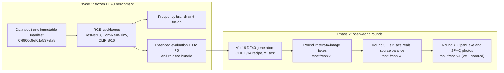
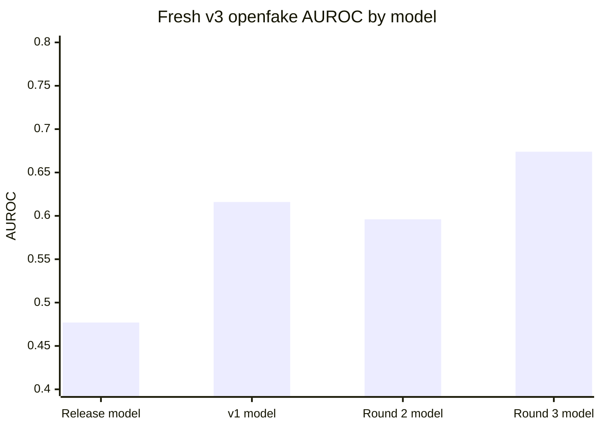
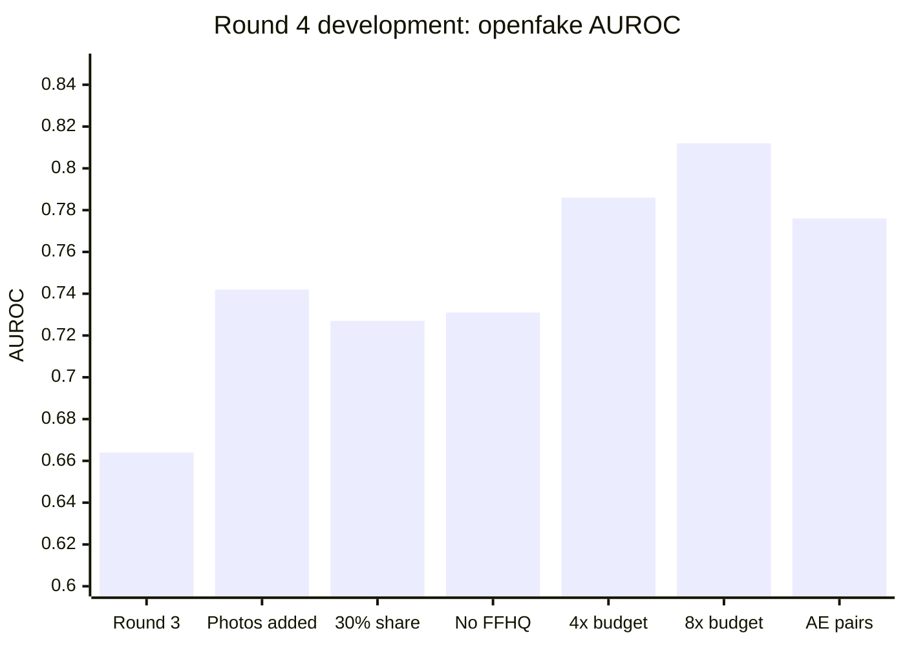

# Generalizable Detection of Face Deepfakes and AI-Generated Face Photos

### From a frozen DF40 benchmark to open-world generalization under leakage control

| | |
|---|---|
| **Run it** | [`notebooks/reproduce.ipynb`](notebooks/reproduce.ipynb) reproduces the main findings from public data in one run ([next section](#reproduce-the-main-findings-in-one-notebook)) |
| **Full pipeline** | git tag `archive/full-research` holds the training code, configs, tests and scripts behind every number in this report |
| **Evidence** | Every number comes from a committed file in `reports/` (Appendix B) |
| **Status** | Finished. Round 4 stopped at development: no candidate reached its 0.85 goal, so its untouched test set (fresh v4) was left unscored (Section 3.7) |

---

## Summary

This project builds and tests detectors that look at a face, in a photo or in a video,
and decide whether it is real or was made or altered by an AI model. A high score on
one dataset came easily. The hard part, and the subject of this report, is keeping that
score on fakes made by methods, cameras and generators the detector never saw in
training. The report follows the work in the order it was done. Technical terms are
explained where they first appear and collected in Section 1.6; models are named by
what they changed (Table 3).

**Phase 1** froze an unseen-method benchmark built from DF40, a public collection of
faces manipulated by 40 different methods. Eight methods applied to FaceForensics++
(FF++) videos were used for training, three for development (choosing the model) and
three for a single final test, and a lineage audit ruled out shared videos, source
clips, identity tokens, pixels and perceptual hashes across these splits.
ConvNeXt-Tiny, selected on development data, beat a ResNet18 baseline on the final FF++
test by +0.110 macro video AUROC (95% CI [0.023, 0.191]; 0.997 vs 0.888). CLIP ViT-B/16
with only its LayerNorm layers and a linear head trained reached 0.999 on FF++ and,
unlike ConvNeXt, transferred to Celeb-DF (0.963 vs 0.639). A frequency branch
(log-amplitude, phase and high-pass inputs) improved neither model: fused with RGB, it
passed the pre-registered test in 0 of 6 comparisons. Extended, pre-registered
evaluations confirmed CLIP's cross-domain advantage (+0.098 over ConvNeXt on seen
methods in the Celeb-DF domain, CI [0.020, 0.169]) and exposed its failures: lip-sync
methods (0.50 to 0.61), strong video compression, and a decision threshold that labels
515 of 517 raw Celeb-DF videos fake.

**Phase 2** retrained for the open world in rounds, each scored once on a newly built
test set. A CLIP ViT-L/14 recipe with LayerNorm tuning, self-blended pseudo-fakes and
GenD feature losses (the v1 model) raised the open-world test score from 0.824 to
0.889. Adding modern text-to-image fakes (the round 2 model) raised the fresh v2 score
from 0.693 to 0.751, but a later analysis showed that much of the gain was a shortcut:
every training real was an FF++ frame, and the models told FF++ reals apart from real
photos of any other source at an AUROC of 0.92 to 0.99. The round 3 model removed this
real-source bias (0.945 to 0.498 on fresh v3, where 0.5 is no bias) by adding FairFace
reals and source balancing, and improved detection of current generators on OpenFake
(0.596 to 0.674). Round 4 added 55,391 AI-generated and real photo faces from OpenFake
and SFHQ-T2I with source-format matching. Its best candidate, trained on 8 times the
round 3 sample budget, reaches development AUROCs of 0.911 (DFF), 0.941 (Celeb-DF
video), 0.973 (SFHQ-T2I) and 0.812 (OpenFake), but its balanced accuracy on OpenFake
(0.687) is far from the 0.85 goal, and FLUX models stay hardest (0.68 to 0.71). We
conclude that pretrained vision-language features with light tuning generalized best
among the models tested, that data shortcuts, not model capacity, explained most of
our failures, and that detection of current photorealistic generators is not solved.

---

## Reproduce the main findings in one notebook

[`notebooks/reproduce.ipynb`](notebooks/reproduce.ipynb) uses public data only: 1,724
AI-generated faces from SFHQ-T2I (FLUX.1-dev, FLUX.1-pro, SDXL) and 2,000 FFHQ, 1,000
FairFace and 1,000 LFW real faces, every download pinned to a dataset revision. It embeds
each image once with a frozen CLIP ViT-L/14 and trains logistic-regression detectors on
the embeddings, with the threshold locked on validation reals at a 5% false-positive
rate. A full run, downloads included, took 15 minutes on a laptop RTX 4050. With the
committed embeddings (`notebooks/features_clip_l14.npz`) it runs in about a minute on a
CPU. To run it: `pip install -r requirements.txt`, then open the notebook (or upload it
to Google Colab). The numbers below are from `notebooks/results.json`.

| Question | Result |
|---|---|
| Fakes and reals of the same kind as in training | AUROC 1.000, balanced accuracy 0.983 |
| Trained on SDXL fakes only, tested on FLUX.1-dev and FLUX.1-pro | AUROC 1.000 on both |
| Real faces from datasets the detector never saw, called fake (target 5%) | FFHQ re-saved as JPEG 6.0%, FairFace 8.0%, LFW 29.7% |
| Can the embeddings tell real datasets apart, with no fakes involved? | AUROC 1.000 for each pair of FFHQ, FairFace and LFW |
| Same fakes, FairFace reals and JPEG copies added to training | LFW false alarms 31.3% to 13.7%; balanced accuracy on FLUX.1-pro vs LFW 0.843 to 0.932 |


The perfect scores do not mean the detector learned what a fake looks like. All fakes
come from one dataset and all training reals from another, so telling the datasets apart
is enough, and the embeddings tell real datasets apart perfectly. A new generator from
the same dataset does not expose this; a new real dataset does: LFW news photos are
called fake six times as often as the target. Adding a second real dataset halves that
but does not remove it. The full project found the same three things at scale:
shortcuts behind the best-looking gains (Sections 3.5 and 3.7), real-source variety as
the main fix (Section 3.6), and current generators from other pipelines staying hard
(FLUX at 0.68 to 0.71 AUROC, Section 3.7).

---

## Table of contents

0. [Reproduce the main findings in one notebook](#reproduce-the-main-findings-in-one-notebook)
1. [Introduction](#1-introduction)
2. [Methods](#2-methods)
3. [Results](#3-results)
4. [Discussion](#4-discussion)
5. [References](#5-references)
6. [Appendix](#6-appendix)

---

## 1. Introduction

### 1.1 The problem

A *deepfake* is a face image or video whose identity, expression or content has been
altered by a generative model. Several quite different techniques fall under that
name, and a detector has to handle all of them:

- A **face swap** replaces the identity of the person in a target video with that of a
  source person while keeping the target's head pose, expression, lighting and
  background. DeepFaceLab, SimSwap and InSwap are examples.
- A **face reenactment** keeps the person's identity but makes the face move as someone
  else's does: a driving video controls the expression and head motion (FOMM, MCNet).
- **Lip-sync and talking-head** methods change only what a person appears to say.
  Wav2Lip rewrites the mouth region of an existing video to match new audio; SadTalker
  animates a single photo from an audio track.
- A **face edit** changes one attribute of a real face, such as age, hair, expression or
  style, and leaves the rest alone (StarGAN, StyleCLIP, e4e).
- **Entire-face synthesis** produces a face of a person who does not exist (StyleGAN,
  diffusion models).

Since 2022 a further kind of synthetic face has become common: photorealistic portraits
produced from a written description by text-to-image diffusion and flow models such as
Stable Diffusion, SDXL, FLUX, Midjourney and GPT Image [27] to [31]. These images are not
edits of a real photo at all. Anyone can produce thousands of them in an afternoon, and
the best ones are hard for people to tell from photographs.

The task in this project is binary classification: given a face (one photo, or the
frames of a video), decide whether it is **real** or **fake**. The detector outputs a
probability that the face is fake. Comparing that probability with a fixed cut-off
value, the *threshold*, turns it into a label.

### 1.2 Why it matters

Synthetic faces are used for impersonation, non-consensual imagery, fraud and
disinformation, and the tools to make them are free and fast. Detection is one of
several defenses next to provenance (signed records of where a file came from) and
watermarking (hidden marks that a generator embeds in its output). It is the only one
that works on media whose creator did not cooperate, because provenance and watermarks
both depend on the creator's tools adding them.

For detection to be useful it must work on manipulations and generators **it has never
seen**, because new ones appear faster than labeled training data can be collected. A
detector that is accurate only on its own benchmark gives false confidence: it reports
"real" for exactly the fakes made with the newest tools, which are the ones most likely
to be used against people.

### 1.3 Why generalization is the hard part

Benchmarks in this field are known to overstate real-world accuracy [1], [2]. Two causes
recur in our own results:

- **Method and domain shift.** A model trained on one set of manipulation methods and
  one video source learns cues specific to them: the blending seam of one face-swap
  tool, the compression of one video platform, the lighting of one studio. When the
  method or the source changes, those cues disappear. In Phase 1, the model that won on
  FF++ dropped from 0.998 to 0.639 AUROC when the same kinds of manipulation were
  applied to celebrity interview videos instead.
- **Shortcuts.** When real and fake images differ in something other than the
  manipulation (source dataset, JPEG history, file format, face size, black padding at
  crop borders), a model can reach high accuracy by reading that difference instead of
  the manipulation [24]. Shortcuts inflate validation scores and fail silently in
  deployment. In our round 2, for example, every real training image came from one
  video dataset, and the model partly learned "not from that dataset means fake". It
  looked better on the test set while not actually getting better at detection.

Because of this, a large part of the work below is about **measurement**: building
splits and test sets that cannot be solved by such cues, and checking for them
explicitly.

### 1.4 Objective and research questions

The objective was a reproducible face-manipulation detector whose accuracy holds on
manipulation methods, real-image sources and generators absent from training, with
every claim supported by a pre-registered comparison on untouched data. We asked:

- **RQ1.** On a leakage-controlled unseen-method benchmark, which backbone
  generalizes best: a CNN baseline (ResNet18), a modern CNN (ConvNeXt-Tiny) or a
  pretrained vision-language transformer (CLIP ViT-B/16)?
- **RQ2.** Does a frequency-domain branch, alone or fused with RGB, add
  generalization?
- **RQ3.** How far does the best recipe transfer to new domains, new generator
  families and real-world conditions (compression, raw video, new real-photo
  sources), and where does it fail?
- **RQ4.** Which changes to training data and recipe improve detection of faces from
  current text-to-image generators, and which apparent improvements are shortcuts?

### 1.5 Contributions

1. A content-addressed, immutable data pipeline: every manifest has an ID derived
   from its content, every image a file hash, a pixel hash and a perceptual hash, and
   every split passes a lineage audit before training.
2. A frozen unseen-method DF40 benchmark with one-time final test export, three
   backbones and a frequency/fusion study (Phase 1).
3. Four open-world rounds, each with a protocol frozen in advance and a test set built
   from sources no earlier split used (Phase 2).
4. Diagnostics that found and removed two shortcuts (real-source identity, alignment
   padding) and three more candidate shortcuts in new data (source file format, JPEG
   quality, FFHQ-style reals).
5. A calibrated inference package (`deepfake-detect`) with a model card (at tag `archive/full-research`).
6. A one-notebook reproduction of the main findings from public data only.

### 1.6 Terms used in this report

This section explains the vocabulary the rest of the report relies on. Readers
familiar with deepfake detection can skip it and come back when a term is unclear.

#### Kinds of fakes and how they are made

- **Generator, method, family.** A *generator* or *method* is one specific tool, such
  as FLUX.1-dev or SimSwap. A *family* groups related tools: all FLUX models, all
  fine-tunes of SDXL, or, at a coarser level, all face swaps. A *fine-tune* is a model
  made by further training a published one; RealVisXL, for instance, is SDXL trained
  further on photorealistic images.
- **GAN.** A generative adversarial network trains a generator against a second
  network that tries to tell its output from real images. The StyleGAN models were the
  first to produce convincing synthetic faces.
- **Diffusion and flow models.** These generate an image by starting from random noise
  and removing it step by step, guided by a text prompt. Stable Diffusion (SD 1.5, SD
  2.1, SDXL, SD 3.5), FLUX and most commercial generators belong to this group.
- **Autoencoder (VAE).** A network that compresses an image into a small *latent*
  representation (the encoder) and expands it back into pixels (the decoder). Most
  modern generators work in this latent space and use the decoder to produce the final
  image, so everything they make passes through the decoder and carries its faint
  traces.
- **Reconstruction.** A real photo passed through an autoencoder's encoder and then
  its decoder. It shows the same person, pose and background as the original, so the
  only difference between the two is the autoencoder's trace. We use such pairs as
  training data to teach the detector that trace and nothing else.
- **Inpainting.** Regenerating only a masked part of a real image, such as the face,
  and keeping the rest.
- **Self-blended image (SBI).** A pseudo-fake made from a single real face without any
  generator: a slightly altered copy of the face (shifted color, scale or position) is
  blended back over the original through a soft face-shaped mask. The result has the
  seams and color mismatches typical of face swaps [9].

#### Data and experimental design

- **Real and fake.** The two labels. Fake is the *positive* class: "detecting" means
  calling a fake image fake.
- **Domain.** A set of fakes evaluated together with reals from the same source,
  written in code style in this report (`dff`, `openfake`, `celebdf_video`). Each
  domain has its own reals, so fakes are always compared with photos that were taken
  and processed the same way.
- **Seen and unseen (held out).** A method is *seen* when training contained examples
  of it and *unseen* or *held out* when it was kept for evaluation only.
- **Train, development (validation) and test splits.** The training split fits the
  model's weights. The development split, also called validation, is used for every
  choice: which architecture, which settings, which epoch. The test split is used once,
  at the end, to measure the chosen model. Using a test set for any decision turns it
  into development data, because the decision adapts to it.
- **Fresh test set.** A test set built for one Phase 2 round from sources that no
  earlier split used, frozen before the round's training starts and scored once. After
  that it is *retired*: it may be used for development, but its numbers no longer count
  as untouched.
- **Pre-registration (frozen protocol).** Writing down and committing the data, the
  comparison, the metric and the success rule before the data is scored, so that the
  result cannot shape the question that was asked.
- **Manifest.** The list of every image a run uses, with its label, split and
  checksums. Its ID is a hash of its content, so any change gives a new ID.
- **Lineage and identity.** Where an image came from: the source video, the original
  clip a manipulated video was made from, the person shown. Two images with shared
  lineage are correlated even if their pixels differ, so they must stay in the same
  split.
- **Leakage.** The same or nearly the same content appearing in training and
  evaluation, which makes scores look better than they are.
- **Perceptual hash (dHash).** A 64-bit fingerprint of an image's coarse brightness
  pattern. Resized or recompressed copies of an image give nearly the same hash, which
  makes it useful for finding near-duplicates.
- **Shortcut.** A property that separates real from fake in a dataset but has nothing
  to do with manipulation, such as file format or which dataset a photo came from. A
  model that learns a shortcut looks accurate until the shortcut is absent.
- **Canonicalization.** Our common preprocessing pipeline (face detection, alignment,
  scale matching and a final JPEG encoding, Section 2.4), applied to every image so
  that real and fake images go through identical steps.

#### Models and training

- **Backbone and head.** The *backbone* is the large network that turns an image into a
  feature vector, a list of numbers that describes it. The *head* is a small layer on
  top that turns the features into a single score.
- **Pretrained weights.** Parameters learned on a large general dataset before our
  training: ImageNet photos for the CNNs, 400 M image and caption pairs for CLIP.
- **Fine-tuning.** Further training of pretrained weights on our task. *Full*
  fine-tuning updates every weight; *parameter-efficient* tuning updates a small part
  and leaves the rest frozen.
- **CNN.** A convolutional neural network, which processes an image with small local
  filters stacked in layers. ResNet18 and ConvNeXt-Tiny are CNNs.
- **Vision Transformer (ViT).** A network that cuts the image into square patches (16 x 16
  pixels for "/16", 14 x 14 for "/14") and lets every patch exchange information with
  every other. "B" (base, 86 M parameters) and "L" (large, 304 M) give its size.
- **CLIP.** A vision transformer trained together with a text encoder to match 400 M
  images with their captions [5]. Its features describe general visual content and are
  not tied to any manipulation method, which is why it is a popular starting point for
  detecting generated images [39].
- **LayerNorm tuning.** Training only the scale and shift parameters of the network's
  LayerNorm layers, plus the head. LayerNorm layers normalize the signals inside each
  transformer block; tuning them changes how strongly existing features are expressed
  without rewriting the features. In CLIP ViT-B/16 this is about 0.04 M of 85.8 M
  parameters, in ViT-L/14 about 0.1 M of 304 M.
- **LoRA.** Low-rank adaptation [48]: small trainable matrices added beside frozen
  weight matrices. It gives more capacity than LayerNorm tuning and far less than full
  fine-tuning.
- **Logit, probability, sigmoid.** The head outputs a *logit*, any real number. The
  sigmoid function maps it to a probability between 0 and 1. *Averaging seed logits*
  means averaging the raw outputs of three models trained with different seeds before
  applying the sigmoid, a small ensemble.
- **Loss (BCE).** Binary cross-entropy, the standard training objective for a
  two-class problem. It falls as the model gives the correct class higher probability
  on training images.
- **Epoch and sample budget.** In Phase 1, an epoch is one pass over the training set.
  In Phase 2 it is a fixed number of training images drawn at random (8,000 or 32,000),
  after which the model is validated. The *budget* is epochs times samples per epoch:
  6 x 8,000 = 48,000 images seen in total.
- **Seed.** The number that fixes every random choice in a run: initial head weights,
  order of samples, augmentations. Training the same recipe with three seeds shows how
  much a result depends on chance.
- **Augmentation.** Random changes applied to training images (cropping, blur,
  compression, noise). They stop the model from relying on details that such changes
  destroy and teach it to tolerate them.
- **Sampling mass.** Training draws images with a weighted sampler. The mass of a group
  is the fraction of draws that come from it; *balanced sampling* gives groups equal
  mass regardless of how many images each has.
- **Early stopping and patience.** Training stops when the validation score has not
  improved for a set number of epochs (the patience), and the best epoch is kept.
- **GenD.** The recipe of Yermakov et al. [8]: CLIP with LayerNorm tuning, features
  scaled to unit length, and two extra losses that shape the feature space (Section
  2.5).

#### Metrics and statistics

These are defined in detail in Section 2.9; short versions:

- **TPR and FPR.** The *true positive rate* is the share of fakes called fake. The
  *false positive rate* is the share of reals wrongly called fake. The *true negative
  rate* (TNR) is 1 minus the FPR.
- **AUROC.** The probability that a randomly chosen fake gets a higher score than a
  randomly chosen real. 0.5 is a coin flip, 1.0 is perfect ranking, and below 0.5 means
  the model systematically ranks reals above fakes.
- **Macro and video-level.** *Video-level* means frame scores are averaged per video
  before computing a metric. *Macro* means the metric is computed for each fake method
  separately and then averaged.
- **Balanced accuracy.** The mean of TPR and TNR at a fixed threshold.
- **Calibration.** Whether a predicted probability of 0.8 is right about 80% of the time.
- **Bootstrap and confidence interval (CI).** Resampling the test set many times to see
  how much a result would vary with a different sample; a 95% CI is the range that holds
  the middle 95% of those resampled results.
- **Real-source bias.** How well the score identifies *where* a real photo came from;
  0.5 means not at all.
- **Guardrail.** A condition a candidate must satisfy besides improving the main
  metric, such as "FF++ accuracy may fall by at most 0.01".

---

## 2. Methods

### 2.1 Overview

The project ran in two phases (Figure 1).

**Phase 1** asked which architecture generalizes best to manipulation methods it has
not seen. It used one fixed benchmark built from DF40. The data was audited and frozen
first, three RGB backbones were trained and one was selected on development data, the
final test was read once, and then a frequency branch and its fusion with the RGB
models were tested the same way. Five further evaluations (P1 to P5) probed the frozen
models on new domains, compression and raw video, and the CLIP model was packaged as a
release.

**Phase 2** asked how to make the detector work in the *open world*, on manipulation
pipelines, real-photo sources and generators unlike anything in the benchmark. It kept
one architecture family and changed the training data and recipe, one round at a time.
Every round followed the same loop:

1. Build a new test set from sources no earlier split used, and freeze it.
2. Write and commit the protocol: training data, candidates, selection rule and success
   criterion.
3. Assemble the training data and check it for leakage against every evaluation image.
4. Train each candidate with three seeds and select on validation data only, subject
   to guardrails.
5. Score the test set once, and retire it.

Each round's selected model is named after its round (the v1 model, the round 2 model,
the round 3 model), and round 4's candidates are named by what they change, such as
"no FFHQ" or "4x budget". Table 3 lists every name. The result files in `reports/` use
short codes (E1 to E11) instead; Appendix F maps them to these names.

**Figure 1. Experimental program.** Each box is a frozen protocol; a test set is scored
once and then becomes development data.



### 2.2 Data sources

The project used public datasets and images we generated ourselves. They fall into four
groups by the role they play; exact revisions and checksums are in the round protocols
and Appendix B.

**Manipulated video benchmarks (Phase 1 and the first open-world protocol).**
**DF40** [1] is the core of Phase 1. It applies 40 manipulation methods (face swaps,
reenactments, edits and full synthesis), mostly to faces from the two video datasets
below, and distributes ready-made face crops; its test archives also hold collections
from other pipelines (CelebA edits, MidJourney, HeyGen and others).
**FaceForensics++ (FF++)** [3] is a set of 1,000 real YouTube videos of mostly frontal,
talking faces and their manipulations; DF40's training
methods are applied to FF++ faces, so FF++ supplies all real frames for Phase 1
training and the primary validation and test domains. **Celeb-DF v2** [4] contains
celebrity interview videos and face-swap fakes made from them. It has different people,
cameras and compression from FF++, so DF40's Celeb-DF versions of the same methods give
a cross-dataset measurement. Raw Celeb-DF videos, processed by our own pipeline, are
also used in evaluation P5 and in the fresh v2 domain `celebdf_video`.

**Face edits and older synthesis.** **CelebA** [18] celebrity photos, edited with
StarGAN, StyleCLIP [20] and StarGANv2 [19], provide face-edit domains: P3 in Phase 1,
and validation and test domains in the first open-world protocol, where e4e [21]
inversions of FF++ frames add one more edit domain.
**FFHQ** [14], a set of high-quality Flickr portraits, supplies the reals of the
`whichfaceisreal` set (where the fakes are StyleGAN faces), of SFHQ-T2I and of the
Stable Cascade validation domain. It was also part of round 4's training data until an
experiment showed it taught a shortcut (Section 3.7).

**Real photos from new sources.** These were added because a detector cannot learn what
a real photo looks like from one video dataset. **FairFace** [13] is a Flickr face
dataset balanced across age, gender and ethnicity (adults only used here); it became
round 3's second real source. **LAION** and **Pexels** photos come with OpenFake (below)
and became round 4's real training photos. **LFW** [22], news photos of public figures,
is a real-only set in fresh v3 that measures false alarms on ordinary photos of real
people. **Unsplash Lite** [25] (only photos submitted before August 2022, so none can be
AI-generated) and **Open Images** [26] supply the reals of fresh v4.

**Modern generated faces.** In round 2 we generated our own training fakes with
**Kandinsky 2.2** [32] and **Sana 600M** [33], plus validation fakes with **Stable
Cascade** [34], and made **MoVQ** [35] and **DC-AE** [36] reconstructions of real faces
(the autoencoders inside Kandinsky and Sana). **DeepFakeFace (DFF)** [16] contains SD 1.5
portraits, SD inpainting and InsightFace swaps of IMDB-WIKI [17] celebrities.
**SFHQ-T2I** [15] contains 1024 px faces from FLUX.1, SDXL and DALL-E 3. **OpenFake** [12]
is a large research dataset of 2.3 M images from 74 text-to-image generators paired with
real LAION, Pexels, ImageNet and DOCCI photos; OpenFakeTiny is its 5,000-image sample.
Finally, for fresh v4 we generated 1,200 photorealistic portraits with **SDXL base**
[28], **RealVisXL V5** [37] and **SD 3.5 Medium** [29] from our own prompt grammar.

#### Dataset links, counts and storage sizes

Public sizes below describe the specified download version, not the smaller subsets
used in our experiments. Generated-data sizes describe output images, not model
weights. Sizes are approximate decimal GB (1 GB = 1,000,000,000 bytes); published
GiB values are converted where applicable. Unverified sizes are left explicit.
External source sizes were checked on 2026-11-10.

| Dataset and link | Short description | Number of images or videos | Download size (GB) |
|---|---|---|---|
| [DF40](https://github.com/YZY-stack/DF40#-quick-start) | Face swaps, reenactments, edits and synthetic faces from 40 methods | Millions of images/frames; exact combined count unverified | Approximately 143 processed: 50 training + 93 testing; separate real-data archives additional |
| [FaceForensics++](https://github.com/ondyari/FaceForensics/blob/master/dataset/README.md) | Real videos and four main facial manipulation methods | 5,000 videos: 1,000 real + 4,000 fake; image count depends on frame sampling | Approximately 10 for c23 videos; 500 for lossless videos; 2,000 for all raw PNG frames |
| [Celeb-DF v2](https://github.com/yuezunli/celeb-deepfakeforensics) | Celebrity videos and face-swap deepfakes | 6,529 videos: 890 real + 5,639 fake | Unverified |
| [CelebA](https://www.tensorflow.org/datasets/catalog/celeb_a) | Celebrity face photographs with attribute annotations; source for editing experiments | 202,599 images | Approximately 1.49 for aligned-image download; edited variants additional |
| [FFHQ](https://huggingface.co/datasets/gaunernst/ffhq-1024-wds) | High-quality, aligned 1024 x 1024 Flickr portraits | 70,000 images | 68.8 for the lossless WebP/WebDataset version used |
| [FairFace](https://huggingface.co/datasets/HuggingFaceM4/FairFace/blob/main/README.md) | Face photographs balanced across demographic categories | 97,698 images per padding configuration | Approximately 2.10 for padding 1.25, the version used |
| [DeepFakeFace (DFF)](https://huggingface.co/datasets/OpenRL/DeepFakeFace) | Real celebrity photos, SD-generated faces, inpainting and InsightFace swaps | 120,000 images: 30,000 real + 90,000 fake | Approximately 5.07 |
| [SFHQ-T2I](https://huggingface.co/datasets/bitmind/SyntheticFacesHighQuality-T2I) | 1024 x 1024 synthetic faces from FLUX.1, SDXL and DALL-E 3 | 122,726 images in the main release | Approximately 22.9 for the main ZIP; repository including sample archive approximately 23.3 |
| [OpenFake](https://huggingface.co/datasets/ComplexDataLab/OpenFake) | Images from numerous generators paired with real photographs | 2,485,971 images/rows in the project snapshot, including Reddit | Full snapshot unverified; approximately 68 for its core test split |
| [OpenFakeTiny](https://huggingface.co/datasets/ComplexDataLab/OpenFakeTiny) | Small OpenFake sample, including a Reddit subset | 5,000 images | 4.88 |
| [LFW](https://huggingface.co/datasets/bitmind/lfw) | Real face photographs of public figures | 13,233 images | 0.188 for the Hugging Face version used |
| [Unsplash Lite](https://unsplash.com/data) | Real photographs with metadata and image URLs | 25,000 photographs referenced | 1.5 for metadata only; project's 510 downloaded usable-face photos approximately 2.6 |
| [Open Images (CVDF mirror)](https://github.com/cvdfoundation/open-images-dataset) | Real photographs with object and face annotations | 1,910,098 images in the downloadable bounding-box subset | Approximately 561; project's 2,567 retained face images approximately 0.8 |

OpenFake's count is from the [pinned project metadata](reports/openworld/openfake_metadata.json),
revision `3247b942f18d39d1fd476b1077852af033d35d8c`: 2,300,034 core training rows,
58,453 core validation rows, 91,397 core test rows and 36,087 Reddit rows. The public
repository has since expanded. Project-specific download sizes for SFHQ-T2I,
OpenFake, Unsplash and Open Images are recorded in the
[round-4 protocol](reports/openworld/round4_protocol.md).

#### Locally generated images and model links

These links lead to model weights; our generated image collections have no public
download links. Counts come from the [round-2 protocol](reports/openworld/round2_protocol.md),
[round-3 protocol](reports/openworld/round3_protocol.md),
[round-3 audit](reports/openworld/round3_audit.json), and
[round-4 protocol](reports/openworld/round4_protocol.md#fresh-v4-seen-slice-fakes).
Retained counts refer to the round-3 audit for the first five rows and fresh v4 for
the final three rows.

| Model and link | Short description | Images generated | Images retained after filtering | Generated-image size (GB) |
|---|---|---:|---:|---|
| [Kandinsky 2.2](https://huggingface.co/kandinsky-community/kandinsky-2-2-decoder) | Text-to-image portraits at 768 x 768 | 2,000 | 1,956 | Not recorded |
| [Sana 600M](https://huggingface.co/Efficient-Large-Model/Sana_600M_512px_diffusers) | Text-to-image portraits at 512 x 512 | 2,000 | 1,987 | Not recorded |
| [Stable Cascade Lite](https://huggingface.co/stabilityai/stable-cascade) | Text-to-image portraits at 1024 x 1024 for validation | 1,000 | 1,000 | Not recorded |
| [MoVQ](https://huggingface.co/kandinsky-community/kandinsky-2-2-decoder/tree/main/movq) | Autoencoder reconstructions of FF++ and FairFace real faces | 4,000 | 3,989 | Not recorded |
| [DC-AE](https://huggingface.co/Efficient-Large-Model/Sana_600M_512px_diffusers/tree/main/vae) | Reconstructions using Sana's deep-compression autoencoder | 4,000 | 3,993 | Not recorded |
| [SDXL Base 1.0](https://huggingface.co/stabilityai/stable-diffusion-xl-base-1.0) | Photorealistic portraits at approximately 1 megapixel | 400 | 398 | Included in combined size below |
| [RealVisXL V5.0](https://huggingface.co/SG161222/RealVisXL_V5.0) | Photorealistic SDXL-based portraits | 400 | 399 | Included in combined size below |
| [SD 3.5 Medium](https://huggingface.co/stabilityai/stable-diffusion-3.5-medium) | Photorealistic portraits for fresh evaluation | 400 | 397 | Included in combined size below |

The final three generators produced **1,200 PNG images totaling approximately
1.6 GB**. Separate storage sizes were not recorded. MoVQ and DC-AE each generated
2,000 FF++ reconstructions in round 2 and 2,000 FairFace reconstructions in round 3.
The raw image files are not included in this checkout, so missing storage sizes
cannot be measured from the committed reports.

### 2.3 Target task and unit of analysis

The detector receives one face and returns the probability that it is manipulated or
generated; fake is the positive class. A photo yields one face. A video yields several:
DF40 distributes up to 8 crops per video, and our own pipeline samples 16 frames per
video for evaluation sets and 32 in the inference tool.

All metrics are computed per **video**: the scores of a video's frames are averaged
first, and a photo counts as a video with one frame. There are two reasons. First, a
long video would otherwise contribute many correlated frames and dominate the metric,
while a short one would barely count. Second, the detector is used this way: a person
asks whether a video is fake, not whether frame 117 is.

### 2.4 Face preprocessing

Every image, in training and in evaluation, real or fake, goes through the same face
pipeline that the inference tool uses. This matters because any processing step that
differs between real and fake images becomes something a model can learn instead of the
manipulation.

1. **Detection.** YuNet (`yunet-2023mar`, pinned by SHA-256) [23], a small and fast face
   detector, finds faces and five landmarks (eyes, nose tip, mouth corners). The largest
   face with confidence of at least 0.80 is kept. Faces under 64 pixels wide in the
   source image are rejected because they hold too little detail to judge, and the
   inference tool answers "abstain" rather than guess.
2. **Alignment.** A similarity transform (rotation, scaling and shift) maps the five
   landmarks onto the standard ArcFace template [38], enlarged by a margin of 1.3 (the
   DeepfakeBench convention [2]), giving a 256 x 256 crop with the eyes in fixed
   positions. In this crop the eyes are about 62 px apart. Where the crop extends beyond
   the source image, the area is filled with black.
3. **Scale matching (open world).** Fakes and reals often come at different
   resolutions: generated portraits are large and sharp, real photos often small. A
   model would learn "sharp face means fake". Within each *collection* (a group of fakes
   together with the reals they are paired with), every face is therefore first
   downscaled (area interpolation) until its eye distance is at most the smallest of
   the per-class median eye distances. Section 3.7 shows how strong this cue was.
4. **Canonical encoding.** Every crop is stored as a JPEG at quality 90 with 4:2:0 chroma
   subsampling (color stored at half resolution, the usual JPEG setting), so all stored
   images share one final encoding.
5. **Source format matching (round 4).** A final JPEG encoding does not erase an earlier
   one: a photo that was a JPEG before keeps traces of that first compression. In round
   4, most fakes came from lossless PNG files and most reals from JPEGs, which is an easy
   shortcut. Before step 4, every source that was not a JPEG is therefore JPEG-encoded
   once, with a (quality, subsampling) pair drawn so that real and fake labels end up
   with the same distribution of pairs. JPEG sources are never re-encoded (Section 3.7).
6. **Model input.** Crops are resized to 224 x 224 (eyes about 54 px apart) and
   normalized with ImageNet or CLIP color statistics.

Phase 1 used DF40's own crops as distributed. On 40 real Celeb-DF frames that DF40 also
cropped, our pipeline reproduces DF40's landmark positions to a median of 4.6 px on a
256 px crop, so models trained on DF40 crops can be applied to faces our pipeline
extracts.

### 2.5 Feature representation

**RGB backbones.** ResNet18 [7] and ConvNeXt-Tiny [6] with ImageNet weights, and CLIP
ViT-B/16 and ViT-L/14 [5] with OpenAI weights at pinned revisions, each turn the 224 px
crop into a feature vector. For CLIP this is the pooled CLS token, a summary vector the
transformer produces for the whole image. A linear head maps the vector to one logit.
"RGB" here means the models see ordinary color pixels, as opposed to the frequency
inputs below.

**Unit-norm features and GenD losses (open world).** Following GenD [8], CLIP features
are scaled to unit length (L2 normalization) before the head, so every image lies on
the surface of a sphere and only the direction of its feature vector matters. Two extra
losses shape where images lie on that sphere [10]:

- the *alignment* loss pulls features of images with the same label close together, and
- the *uniformity* loss pushes all features to spread evenly over the sphere.

Together they discourage the model from squeezing everything into a few directions that
happen to separate the training methods, which is one way overfitting shows up in
feature space.

**Frequency branch (Phase 1).** Many generators leave regular patterns that are hard to
see in pixels but stand out in the frequency domain, the representation of an image as
a sum of waves of different fineness and direction [11]. The frequency branch is a
ResNet18 with a rebuilt first layer that reads three inputs computed from each crop:

- the *log-amplitude spectrum*, how strongly each spatial frequency is present (on a log
  scale, since the values span many orders of magnitude);
- the *phase spectrum*, where those waves are positioned, which carries most of an
  image's structure; and
- a *high-pass residual*, the image minus a blurred copy of itself, which keeps only
  fine detail and noise.

An optional learnable spectral filter lets the network reweight frequencies before the
convolution layers.

**Low-level shortcut probe.** For every test set we compute a few simple image
statistics that know nothing about faces: JPEG file size at a fixed quality (how much
fine detail and noise an image holds), color saturation, sharpness (variance of the
Laplacian), contrast (standard deviation of luminance) and the share of high-frequency
energy. Each statistic is used alone as a classifier. The best one's AUROC measures how
far the set could be solved without looking at the face; a high value warns that the
set contains a shortcut.

### 2.6 Splits, protocols and leakage control

**Immutable manifests.** Training never reads a directory. It reads a manifest whose ID
is a hash of its content, checks that every image file exists and matches its
checksum, and refuses to run otherwise. Rebuilding from identical inputs gives the same
manifest ID, and a single changed byte gives a different one, so every result can be
traced to the exact images behind it.

**Lineage audit.** Before any training, a split must show no overlap between train,
validation and test in any of these: video ID, FF++ source clip, Celeb-DF identity token,
exact file hash, decoded-pixel hash (the same image saved differently) and 64-bit
perceptual hash. When two splits collide, the lower-priority group is removed (priority:
test, then validation, then train). In Phase 1 this removed 24 frames from one video
group. From round 3 on, a further check catches near-duplicates that hashes miss: any
training addition whose 32 x 32 grayscale thumbnail correlates at 0.99 or more with an
evaluation image is removed, together with its whole video group. The 0.99 threshold was
calibrated on unrelated images: unrelated faces reached at most 0.988, while resized,
recompressed copies of the same image scored at least 0.9988. (A perceptual hash alone
could not do this among aligned faces: for a quarter of round 2 training images some
unrelated evaluation face lay within 6 bits.)

**Phase 1 roles.** In Phase 1 whole methods, not just images, are split, so the final
test measures methods the model has never seen (Table 1). The development and test
roles each contain one face swap, one reenactment and one synthesis method, so both
cover every kind of manipulation the training data does.

**Table 1. Frozen DF40 unseen-method protocol** (manifest `07f906d9ef61a537efa8`,
11,640 frames, at most 8 frames per video).

| Role | Face swap | Reenactment, lip-sync, talking head | Entire-face synthesis |
|---|---|---|---|
| Train | SimSwap, BlendFace | Wav2Lip, FOMM, SadTalker | StyleGAN2, SD-2.1, DiT |
| Development (model selection) | FaceDancer | MRAA | StyleGAN3 |
| Final test (exported once) | UniFace | MCNet | RDDM |

FF++ is the primary domain. Celeb-DF versions of the same methods are a separate
cross-dataset measurement that never influenced any choice. Training used 4,776 fake and
4,800 real frames. Identity separation relies on the identity units the datasets
provide (FF++ source clip IDs and Celeb-DF `idNN` tokens); these prevent known source
reuse across splits but do not prove that two different FF++ clips never show the same
person.

**Phase 2 test sets.** Each round builds a new test set from sources no earlier split
used, freezes the protocol, selects the model on validation data only, and scores the
test set once. A used test set is retired and becomes development data. There were four
test sets:

- **v1 test** (part of manifest `adf10611e74ccef2191d`, which holds all 79,142 images of
  the first open-world protocol). It contains seven DF40 generators held out from
  training (UniFace, InSwap, MCNet, HyperReenact, PIRender, RDDM and PixArt, applied to
  both FF++ and Celeb-DF faces) and six collections from other pipelines: DeepFaceLab
  swaps, HeyGen talking-head videos, MidJourney portraits, CollabDiff and StarGANv2
  edits, and e4e inversions of FF++ frames. It was scored once at the end of v1 and
  retired.
- **Fresh v2** (manifest `b209f9bcef05d95af5c1`, 27,970 images) has three domains.
  `celebdf_video` takes raw Celeb-DF v2 videos (599 fake, 732 real) and runs them through
  our own pipeline, 16 frames per video, exactly as the inference tool would. `dff` is
  DeepFakeFace: 2,470 fakes (SD 1.5 portraits, SD inpainting and InsightFace swaps)
  against 708 real IMDB-WIKI celebrity photos. `sfhq_t2i` is 1,715 FLUX.1 and SDXL faces
  against 2,000 FFHQ reals. To keep this test untouched, round 2 was not allowed to train
  on any of these generators or on any model sharing their autoencoders. Fresh v2 was
  scored in round 2 and again, for continuity, in round 3, then retired.
- **Fresh v3** (manifest `f8fb7343da06e7a81dd7`, 3,823 images) targets current
  text-to-image generators. `openfake` takes all three splits of OpenFakeTiny (946 fake,
  454 real faces from dozens of generators). `openfake_reddit` is OpenFakeTiny's Reddit
  subset (383 fake, 40 real); it has too few reals and a strong low-level shortcut, so
  it is reported but never used for a decision. `lfw` is 2,000 real news photos, one per
  person, used to measure false alarms. Fresh v3 was scored in round 3 and in its
  ablation, then retired.
- **Fresh v4** (manifest `c4cdc65a70672c3d1ad2`, 4,850 photos) is round 4's test set.
  `v4_photos_seen` has 1,194 portraits that we generated with SDXL base, RealVisXL V5 and
  SD 3.5 Medium (generator families that round 4 trains on, but with our own prompts),
  against 946 real Unsplash and Open Images faces. `v4_photos_unseen` has 1,776 fakes from
  16 generators that OpenFake keeps for its own test split and that never enter our
  training, against 934 real faces. It is built and frozen, and **has not been scored**.

### 2.7 Models

#### 2.7.1 Phase 1 backbones

Three RGB backbones were compared, plus the frequency branch (Table 2). They were chosen
to span the range from "small and well understood" to "large and pretrained on
something other than faces":

- **ResNet18** is a standard, well-understood baseline. Only its last residual stage and
  the head are trained, after one epoch of training the head alone.
- **ConvNeXt-Tiny** is a strong modern CNN of similar cost to CLIP B/16. All of its
  weights are trained (full fine-tuning).
- **CLIP ViT-B/16** was included because features learned from 400 M image and caption
  pairs are not tied to any one manipulation and have been reported to transfer across
  generators [39]. Training only its LayerNorm layers keeps those features while adapting
  their statistics to the task, and leaves little room to memorize the training methods.

**Table 2. Phase 1 models** (configs `configs/training/df40_unseen_*.yaml` at tag `archive/full-research`).

| Model | Pretrained on | What is trained | Parameters |
|---|---|---|---:|
| ResNet18 (baseline) | ImageNet | last residual stage and head (head alone in epoch 1) | 11.2 M |
| ConvNeXt-Tiny | ImageNet | all weights | 28 M |
| CLIP ViT-B/16 | 400 M image and caption pairs (OpenAI, revision `57c2164`) | LayerNorm parameters and linear head only | 85.8 M, of which about 0.04 M train |
| Frequency ResNet18 | ImageNet, with a new spectral input layer | new input layer from epoch 1, the rest after a warm-up epoch | 11.3 M |

All RGB runs used the AdamW optimizer (weight decay 1e-4), 5 epochs with early stopping
after 2 epochs without improvement, and mixed precision (16-bit arithmetic where safe,
to save memory and time). Batch size and learning rate were set per model: 64 and 1e-4
for ResNet18, 16 and 2e-5 for ConvNeXt-Tiny, 16 and 5e-5 for CLIP. The frequency branch
used batch 64, learning rate 1e-4 and 8 epochs with patience 3.

Sampling was balanced by method and by video, so that a method or a video with many
frames does not get more weight than one with few. Augmentation was moderate: a random
resized crop (keeping 88 to 100% of the image), horizontal flips, JPEG re-encoding at
quality 35 to 95 for 55% of images and Gaussian blur for 20%.

A fourth architecture, E-ConvNeXt, was considered and left out: its public reference is
a Paddle implementation without a matching, pinned PyTorch checkpoint, so including it
would have changed both framework and initialization at once.

#### 2.7.2 Frequency branch and fusion

The frequency branch was first trained and evaluated alone, then combined with each
frozen RGB finalist in three ways:

- **(a) Equal logit averaging:** the two models' logits are averaged with equal weight.
- **(b) Tuned scalar blend:** a weighted average whose RGB weight (0.00 to 1.00 in steps
  of 0.05) was chosen to maximize FF++ development AUROC. A weight of 1.00 would mean
  "ignore the frequency branch".
- **(c) Gated head:** a small network trained on the concatenated feature vectors of
  both models, which can learn when to trust which.

All weights were fixed, and their checkpoint hashes committed, before the final test
was read.

#### 2.7.3 Open-world recipe

All Phase 2 models share one architecture: **CLIP ViT-L/14** (304 M parameters,
revision `32bd6428`) with LayerNorm tuning, unit-norm features and a linear head. The
recipe was built up step by step in v1 (Section 3.4) and then held fixed, so that later
rounds could attribute changes to data. Its ingredients, as used from the v1 model
onward (with round 4's values where they differ):

- **Optimizer and schedule.** AdamW with learning rate 5e-5 for the LayerNorm parameters
  and 1e-3 for the head (the head starts from scratch, so it can move faster), weight
  decay 1e-4. The learning rate rises linearly over the first 3% of training (warm-up)
  and then decays to zero along a cosine curve.
- **Memory.** Batch size 32 with bfloat16 arithmetic and gradient checkpointing
  (recomputing some intermediate values instead of storing them), which is what lets a
  304 M-parameter model train on an 8 GB GPU.
- **Budget and selection.** Six epochs of 8,000 sampled images (the v1 to round 3
  models), or six of 32,000 or 64,000 (round 4's "4x budget" and "8x budget"), with
  validation after each epoch. The epoch with the best validation score is kept, and
  training stops early after 3 epochs without improvement. (The first five steps of the
  v1 recipe search used six epochs of 32,000 with patience 2; Section 3.4 explains the
  change.)
- **Self-blended images.** For each real image the sampler can draw a self-blended
  pseudo-fake made from it (Section 1.6). Pseudo-fakes take 30% of the fake sampling
  mass. They teach the general signature of pasting a face into a frame without tying
  the model to any one swap tool [9].
- **GenD losses.** Alignment and uniformity, each with weight 0.1 next to the main
  classification loss [8].
- **Strong augmentation.** Random resized crop, flips and slight color jitter; for 25% of
  images a downscale to 35 to 90% of the size and back up (simulating low-resolution
  sources); Gaussian blur (20%); simulated camera sensor noise (15%); and either H.264
  video compression (15%, CRF 18 to 40, where a higher CRF means stronger compression) or
  JPEG compression (45%, quality 30 to 95). These destroy fine pixel detail on purpose,
  so the model must also use cues that survive real-world processing.
- **Alignment-padding augmentation (round 3 onward).** Half of all images, real and fake
  alike, get a black margin along one or two edges, 4 to 30% deep and slightly tilted.
  This removes the "black border means real" shortcut described in Section 3.6.
- **Real-source balance (round 3 onward).** Each real-source namespace gets an equal share
  of the real sampling mass: FF++ and FairFace in round 3, joined by LAION and Pexels in
  round 4. Without it, a source
  made of single photos would outweigh a video source, because every photo counts as a
  whole video group.
- **Addition share (round 4, from "30% share" onward).** Round 4's additions are
  sampled as their own group with 30% of the total mass, so that round 3's data keeps
  its relative weights.
- **Seeds.** Every candidate is trained three times, with seeds 20261007, 20261008 and
  20261009. From round 3 on, a candidate's score is computed from the three models'
  averaged logits; in v1 and round 2, seed scores were averaged instead.

Table 3 names every open-world model and shows how it differs from the one before it.
Bold rows are the models each round selected.

**Table 3. Open-world models and what each changed.**

| Name | Round | Training data | Recipe change |
|---|---|---|---|
| Recipe search, steps 1 to 6 | v1 | 19 DF40 generators on FF++ | stepwise: L/14, strong augmentation, SBI, GenD (Table 10) |
| **v1 model** (step 7) | v1 | same | all of the above, validated every 8,000 samples |
| **Round 2 model** | 2 | + Kandinsky 2.2 and Sana faces, MoVQ and DC-AE reconstructions of FF++ (17,925 rows) | none |
| **Round 3 model** | 3 | text-to-image fakes re-paired with FairFace reals; reconstructions of FairFace | real-source balance, padding augmentation |
| Photos added | 4 | + 55,391 OpenFake and SFHQ-T2I faces | none |
| 30% share | 4 | same | additions sampled at 30% of the mass |
| No FFHQ | 4 | without the 9,000 FFHQ reals | as 30% share |
| 4x budget | 4 | as no FFHQ | 6 x 32,000 samples instead of 6 x 8,000 |
| **8x budget** | 4 | as no FFHQ | 6 x 64,000 samples |
| LoRA | 4 | as no FFHQ | 4x budget, with LoRA adapters added to LayerNorm tuning |
| Autoencoder pairs | 4 | as no FFHQ, + 5,600 real faces paired with their reconstructions by four autoencoders | 4x budget |

### 2.8 Model selection

Model selection is the step where most accidental leakage happens, so its rules were
fixed in advance.

- **Phase 1:** the architecture with the highest FF++ development macro AUROC became
  the finalist, and the choice was recorded and committed before the test export.
  Celeb-DF numbers were visible during development but, by rule, never influenced
  selection. The export command itself checks the manifest audit and the checkpoint
  hash, and refuses to overwrite an existing final export, so the test cannot be
  read twice by accident.
- **Phase 2:** within a run, the epoch is chosen by the *validation score*, the mean of
  macro AUROC over the validation domains. Between candidates, a candidate advances only
  if it beats the previous round's model on its round's target metric while respecting
  two guardrails: FF++ validation AUROC may fall by at most 0.01, and (from round 3) the
  real-source bias may rise by at most 0.03. The guardrails exist because each round
  broadens the training data, and broadening can silently cost accuracy on the original
  benchmark or reintroduce a shortcut. If no candidate qualifies, the round's test set
  stays unscored and can be used later.

### 2.9 Evaluation metrics and statistics

**Macro video AUROC (the primary metric).** AUROC, the area under the receiver operating
characteristic curve, answers one question: if we pick one fake and one real at random,
how often does the fake get the higher score? An AUROC of 0.5 is a coin flip, 1.0 means
every fake outranks every real, and a value below 0.5 means the model ranks them the
wrong way round. AUROC does not depend on any threshold, and it does not change if a
test set has twice as many fakes as reals. We compute it per video (Section 2.3) and per
method: the fakes of each method are compared with all reals of the same domain, and the
per-method values are averaged. This *macro* average stops one easy method with many
videos from hiding a hard one. A domain with three methods scoring 1.00, 1.00 and 0.40
gets a macro AUROC of 0.80, not something close to 1.0.

**Average precision (AP).** The area under the precision-recall curve. It is reported
for completeness but never used for a decision, because its floor is the share of fakes
in the test set: random scores on a set that is 90% fake already give an AP of about
0.90. In round 3 the release model reached an AP of 0.693 on `openfake` (68% fake) with
an AUROC of 0.477, which is chance.

**TPR at 1% FPR.** Set the threshold so that only 1% of real videos are flagged, and
report the share of fakes caught. This is the operating region that matters for
screening large amounts of media, where even a small false-alarm rate produces many
false accusations.

**Brier score and ECE-10.** These measure *calibration*, whether probabilities can be
read as probabilities. The Brier score is the mean squared difference between the
predicted probability and the true label (0 or 1); lower is better. The 10-bin expected
calibration error (ECE) sorts predictions into ten bins by predicted probability,
compares each bin's average prediction with the actual share of fakes in it, and
averages the gaps, weighted by bin size [42]. An ECE of 0.09 means predictions are off
by about 9 percentage points on average.

**Balanced accuracy at a locked threshold (round 4).** Balanced accuracy is the mean of
TPR and TNR at one threshold. Unlike plain accuracy, it cannot be inflated by the mix of
the test set: a model that calls everything fake gets 0.50, not the fake share. The
threshold is *locked* on validation data before the test is scored: it is the value
that maximizes mean balanced accuracy over the target validation domains, subject to at
most 10% false positives on validation reals, with every real source weighted equally.
This makes balanced accuracy the measure closest to deployment, where one threshold
must serve every kind of input. Round 4's goal is stated in it.

**Real-source bias (round 3 onward).** Standard domain metrics compare each domain's
fakes only with that domain's own reals, so they cannot see a detector that simply calls
every photo unlike its training reals "fake". The real-source bias measures this
directly. For each real source, we compute the AUROC of the detector's score with FF++
validation reals as one class and that source's reals as the other; then we average over
sources. No fakes are involved. A value of 0.5 means the score carries no information
about where a real photo came from, which is what a detector of manipulation should do.
A value of 1.0 means the score perfectly identifies the source.

**Shortcut probe.** The best single low-level image statistic's AUROC (Section 2.5). It
flags test sets that could be solved without looking at the face; slices above 0.70 are
reported but not used for a decision.

**Uncertainty.** A difference between two models on one test set could be luck: a
slightly different sample of test videos might reverse it. We estimate this with a
paired bootstrap of 2,000 replicates [40]. Each replicate draws a new test set of the
same size from the original, with replacement, scores *both* models on it (that is the
"paired" part) and records the difference. The middle 95% of the 2,000 differences is
the 95% confidence interval. Frames from the same source clip are strongly correlated,
so in Phase 1 we resample whole source-lineage groups instead of single videos; otherwise
the interval would come out too narrow. In Phase 2 we resample within each label,
stratified by domain and method, so every replicate keeps the original balance.

A *clear improvement* (Phase 1, round 2) required a gain of at least 0.05 with the 95%
interval above zero. When a model was trained with several seeds, we report the mean
and the sample standard deviation (written mean ± SD).

### 2.10 Inference package

The release bundle (`deepfake-detect`) turns a model into a tool that takes a file and
returns a decision. It applies the face policy of Section 2.4 and, for a video, samples
32 evenly spaced frames; it needs at least 4 accepted faces and otherwise abstains. It
averages the frame probabilities, applies Platt scaling [41] (a logistic function,
fitted on FF++ development videos, that maps raw scores to calibrated probabilities) and
compares the result with a threshold fixed on development data (0.2656). It reports the
probability, the label (FAKE, REAL or ABSTAIN) and the face decisions behind it. The
released model is the Phase 1 CLIP ViT-B/16, documented in `MODEL_CARD.md` (at tag
`archive/full-research`, with the package itself); no open-world model was released.

### 2.11 Software, hardware and reproducibility

Python 3.14, PyTorch 2.14.1 [43] with CUDA 13, Hugging Face Transformers 4.57.6 [44]
and Diffusers 0.35.2 [45], OpenCV [46], pandas, Pillow. All GPU work ran on one RTX 5060
(8 GB) through a shared one-slot job queue. Seeds fix Python, NumPy and PyTorch RNGs,
the weighted sampler and each data-loader worker; cuDNN runs deterministically. Each
run stores its config, a hash of the training source files, the manifest ID and the
checkpoint hash. The test suite (204 tests with PyTorch installed) ran in CI. This
branch keeps only the report, the result files and the one-notebook reproduction; the
code, configs, tests and the round 4 experiment notebook are at git tag
`archive/full-research`, and Appendix A lists the commands for each phase.

---

## 3. Results

### 3.1 Phase 1: backbone selection and final unseen-method test

Each backbone was trained on the eight training methods and scored on the three
development methods (FaceDancer, MRAA and StyleGAN3). ConvNeXt-Tiny, the leader after
one seed, was trained with two more seeds to check that its lead was not luck (Table 4).

**Table 4. Development-only selection** (recorded 2026-10-06, before any test export).
Macro video AUROC on the development methods.

| Model | Seed | Best epoch | FF++ dev | Celeb-DF dev (not used) |
|---|---:|---:|---:|---:|
| ResNet18 | 20261006 | 5 | 0.8617 | 0.8801 |
| CLIP ViT-B/16 | 20261006 | 5 | 0.9635 | 0.9459 |
| ConvNeXt-Tiny | 20261006 | 4 | **0.9778** | 0.7619 |
| ConvNeXt-Tiny | 20261007 | 4 | 0.9679 | 0.6380 |
| ConvNeXt-Tiny | 20261008 | 3 | 0.9625 | 0.6995 |

ConvNeXt-Tiny was frozen as the finalist (three-seed mean 0.9694 ± 0.0078). Its weak
Celeb-DF development numbers were already visible, but by the protocol they did not
change the choice. The one-time test export then scored the ResNet18 baseline, CLIP (as
an independent architecture comparison) and all three ConvNeXt checkpoints on the three
test methods (Table 5).

**Table 5. Final FF++ test on unseen methods UniFace, MCNet and RDDM** (video level,
exported once). Lower is better for Brier and ECE.

| Model | AUROC | AP | TPR@1%FPR | Brier | ECE |
|---|---:|---:|---:|---:|---:|
| ResNet18 (baseline) | 0.8884 | 0.8486 | 0.6889 | 0.1054 | 0.1483 |
| CLIP ViT-B/16 | **0.9990** | **0.9971** | 0.9556 | 0.0267 | 0.1144 |
| ConvNeXt-Tiny, seed 20261006 | 0.9985 | 0.9957 | 0.9333 | 0.0328 | 0.0822 |
| ConvNeXt-Tiny, three-seed mean | 0.9974 ± 0.0010 | 0.9941 | **0.9630** | **0.0205** | **0.0554** |

ConvNeXt beat ResNet18 by **+0.1101** macro AUROC, 95% CI **[0.0227, 0.1913]** over 37
source groups. That passes the pre-registered clear-improvement gate, and the other two
seeds passed too (+0.1086, +0.1081). Per method, the frozen ConvNeXt scored 0.9985 on
MCNet, 1.0000 on RDDM and 0.9970 on UniFace; CLIP scored at least 0.999 on all three.
On FF++, then, both stronger models detect methods they have never seen almost
perfectly. The open question is whether that holds on different footage. The same
checkpoints, scored on the Celeb-DF versions of the three test methods, answer it
(Table 6).

**Table 6. Celeb-DF transfer of the same checkpoints** (never used for selection).

| Model | AUROC | AP | TPR@1%FPR | ECE |
|---|---:|---:|---:|---:|
| ResNet18 | 0.8580 | 0.6760 | 0.2222 | 0.2944 |
| CLIP ViT-B/16 | **0.9630** | **0.9127** | **0.6667** | 0.4402 |
| ConvNeXt-Tiny, seed 20261006 | 0.6389 | 0.3786 | 0.0000 | 0.6692 |
| ConvNeXt-Tiny, three-seed mean | 0.6605 ± 0.0348 | 0.3931 | 0.0185 | 0.6379 |

**Finding.** The FF++ finalist does not transfer. ConvNeXt falls to 0.66 on Celeb-DF,
below even the ResNet18 baseline, and catches almost no fakes at a 1% false-alarm
rate; per method it scores 0.537 on MCNet, 0.611 on RDDM and 0.769 on UniFace. CLIP keeps
0.963. The fully fine-tuned model learned FF++ so well that it learned FF++ itself. Only
five Celeb-DF source groups exist, so these intervals are wide (Section 4.4), but the
gap is far larger than the seed spread. Because of this result, the
released model became CLIP, and Phase 2 built on CLIP.

### 3.2 Phase 1: frequency branch and fusion

**Choosing the inputs.** The frequency branch was developed the same way as the RGB
models, on development data only. An input ablation with one seed compared single and
combined inputs (FF++ development AUROC): log-amplitude alone 0.8775, log-amplitude with
phase 0.8716, high-pass residual alone 0.8909, all three 0.9022, and all three with the
learnable spectral filter **0.9032**. Combining inputs helped on FF++ and much
more on Celeb-DF (0.81 to 0.83 with all three inputs, against 0.52 to 0.72 with fewer). The two all-input
variants were within noise of each other, so both were trained with two more seeds; the
filtered version won on the three-seed mean (0.9012 ± 0.0066 against 0.8981 ± 0.0117)
and was frozen. Its margin was smaller than either variant's seed spread, so the
selection record explicitly does not claim that the filter helps.

**Final test.** Table 7 shows the frozen frequency branch alone and in each fusion,
averaged over its three seeds.

**Table 7. Final test, frequency branch and fusions** (FF++ unseen methods, macro
AUROC, mean over three frequency seeds).

| Variant | with ConvNeXt-Tiny | with CLIP ViT-B/16 |
|---|---:|---:|
| RGB alone | 0.9974 | 0.9990 |
| Frequency alone | 0.9304 | 0.9304 |
| Equal-logit average | 0.9908 | 0.9829 |
| Validation-tuned scalar blend | 0.9969 | 0.9979 |
| Celeb-DF: RGB alone | 0.6605 | 0.9630 |
| Celeb-DF: tuned blend | 0.6677 | 0.9259 |

The pre-registered test (tuned blend minus the same RGB model) passed in **0 of 3 seeds
for each backbone**. For CLIP the blend was significantly *worse* on Celeb-DF in every
seed (−0.025 to −0.062, intervals below zero); the equal-weight average was worse still
(0.807 on Celeb-DF). The development data had already hinted at this: the tuned RGB
weights were 0.80 to 1.00, meaning the frequency branch was given at most a fifth of the
say, and for one ConvNeXt seed none at all.

The frequency branch alone is a reasonable detector (0.930 AUROC, perfect on RDDM), but
it adds no information that the RGB models lack, and it is weaker exactly where the RGB
models are already strong. Fusion would also cost extra compute: CLIP plus frequency is
97.1 M parameters and 4.3 ms per image instead of 3.0 ms. A gated fusion head was also
tried; when retrained with the same seed for the final run, its heads did not reproduce
the development checkpoints byte for byte (in 6 of 6 pairs), so the tested heads were not
the ones selected, and the gated results were excluded from both verdicts.

### 3.3 Phase 1: extended evaluation of the frozen models

The frozen test answered "does the model detect new methods on familiar footage?". Five
further protocols, P1 to P5, were pre-registered before their data was selected, each
asking a different question:

- **P1, seen methods on FF++** (20 new videos per training method): how well do the
  models handle the methods they trained on, on new FF++ clips? This is the easiest case
  and a sanity check.
- **P2, seen methods in the Celeb-DF domain** (10 videos per method): the same methods on
  Celeb-DF faces. Because the methods are familiar, any drop here is caused by the change
  of footage alone, which separates *domain shift* from *method shift*.
- **P3, StarGANv2 edits of CelebA** (300 fake and 300 real images): an unseen family
  (face editing) on an unseen domain (celebrity photos).
- **P4, robustness:** the frozen test sets re-scored after JPEG compression, resizing,
  blur, noise, cropping and H.264 video compression at several strengths.
- **P5, raw Celeb-DF video through the full pipeline** (the 518 official test videos):
  the closest thing to deployment, with our own face detection and frame sampling, the
  calibration and the threshold all included.

Three hypotheses were stated in advance: H3, that the two stronger models beat ResNet18
on seen methods (P1); H1, that CLIP beats ConvNeXt on seen methods in the Celeb-DF domain
(P2); and H2, that CLIP beats ConvNeXt on raw video (P5).

**Table 8. Extended evaluation** (video macro AUROC; three seeds where shown).

| Protocol | Release CLIP (seed 20261006) | CLIP, 3 seeds | ConvNeXt-Tiny, 3 seeds | ResNet18 |
|---|---:|---:|---:|---:|
| Unseen methods, FF++ (frozen test) | 0.999 | 0.998 ± 0.001 | 0.997 ± 0.001 | 0.888 |
| P1: seen methods, FF++ | 0.986 | 0.987 ± 0.001 | 0.992 ± 0.003 | 0.866 |
| Unseen methods, Celeb-DF | 0.963 | 0.933 ± 0.029 | 0.661 ± 0.035 | 0.858 |
| P2: seen methods, Celeb-DF domain | 0.819 | 0.800 ± 0.016 | 0.719 ± 0.006 | 0.758 |
| P3: StarGANv2 edits of CelebA | 0.806 | 0.814 ± 0.013 | 0.634 ± 0.013 | 0.452 |
| P5: raw Celeb-DF v2 videos, full pipeline | 0.749 | n/a | 0.654 (one seed) | 0.607 |

Outcomes of the pre-registered hypotheses:

- **H3 (seen methods, FF++):** ConvNeXt and CLIP beat ResNet18 by +0.120 to +0.129, with
  every interval above +0.07 (142 source groups). **Supported.** On methods they trained
  on, both are close to ceiling.
- **H1 (domain shift):** CLIP beats ConvNeXt on seen methods in the Celeb-DF domain by
  **+0.098, CI [+0.020, +0.169]** (30 source groups). **Supported.** ConvNeXt scores 0.719
  here, below ResNet18, even though it trained on every one of these methods. Its
  earlier Celeb-DF collapse is therefore mainly domain shift, not only unseen methods.
- **H2 (raw video):** CLIP minus ConvNeXt on raw Celeb-DF video is +0.095, CI [−0.013,
  +0.131]. **Not supported.** The point estimate favors CLIP, but the interval includes
  zero: swap videos link most Celeb-DF identities into one large group (one identity
  component holds 335 of 518 videos), which leaves few independent groups to resample.

P3 adds a further point: on StarGANv2 face edits, ResNet18 scores 0.452, below chance,
while CLIP reaches 0.814.

**Method blind spots.** Per method, on Celeb-DF faces, CLIP detects identity swaps and
full synthesis well (BlendFace 0.954, SimSwap 0.956, SD 2.1 0.997, StyleGAN2 1.000) but
not lip-sync or talking-head reenactment (SadTalker 0.503, Wav2Lip 0.613), although it
trained on both. These methods change only the mouth or the motion, and a model that
looks at single frames cannot see the temporal inconsistency that gives them away.

**Robustness (P4).** Table 9 shows a selection of the corruption results on the frozen
FF++ test; the full grid is in `reports/experiments/df40_extended_evaluation.md`.

**Table 9. Robustness on the frozen FF++ test** (macro video AUROC after each
corruption; seed 20261006 for the two stronger models). Blur σ is in pixels, noise σ
in 0 to 255 intensity units, and a higher H.264 CRF means stronger compression.

| Model | Clean | JPEG q90 | JPEG q30 | Resize to 25% | Blur σ 2 | Noise σ 10 | H.264 CRF 38 |
|---|---:|---:|---:|---:|---:|---:|---:|
| ResNet18 | 0.888 | 0.878 | 0.818 | 0.779 | 0.778 | 0.671 | 0.701 |
| ConvNeXt-Tiny | 0.999 | 0.916 | 0.835 | 0.760 | 0.665 | 0.682 | 0.686 |
| CLIP ViT-B/16 | 0.999 | 0.981 | 0.898 | 0.888 | 0.875 | 0.806 | 0.731 |

Every model degrades. Strong H.264 compression (CRF 38) is the most damaging corruption
across the board: on FF++ it brings the three models to 0.63 to 0.73 (frozen test and
P1), and on seen methods in the Celeb-DF domain (P2) to 0.50 to 0.56. CLIP degrades least
under JPEG, resizing, blur and noise. ConvNeXt is fragile: even a light JPEG
re-encoding at quality 90 costs it 0.08, a sign that it relies on fine pixel detail that
any recompression changes.

**The threshold does not transfer (P5).** On raw Celeb-DF video, the release model ranks
videos usefully (AUROC 0.749, and 0.752 on the 384 videos whose identities never appeared
in DF40 development data), but its FF++-calibrated threshold labels 515 of the 517
decided videos FAKE, with one abstention. Its accuracy (0.66) therefore equals the share
of fakes. Calibration breaks down in the same way: ECE is 0.09 on FF++ but 0.28 to 0.49 on
Celeb-DF. In practice the probability should be treated as a ranking score outside
FF++-like footage, and the threshold refit on labeled data from the target domain.

**Seed spread.** Two more CLIP seeds, trained after the release with the frozen
configuration, scored 0.998 on the FF++ test but 0.904 and 0.932 on Celeb-DF. The
release seed (0.963) is CLIP's best; the three-seed mean is 0.933 ± 0.029. Single-seed
figures are optimistic, which is why every Phase 2 candidate was trained with three seeds.

**Whole frames (exploratory, not pre-registered).** Feeding the face-crop models whole
frames instead of aligned face crops lowers raw Celeb-DF AUROC for every model (CLIP
0.749 to 0.610 stretched or 0.641 letterboxed). This rules out swapping the input of
these models, not a model trained on whole frames.

**Cost.** Measured on the RTX 5060 with mixed precision, CLIP B/16 runs at 3.0 ms per face
at batch size 1 and 658 faces per second at batch size 32, with a 564 MiB memory peak.
ConvNeXt-Tiny takes 2.0 ms and ResNet18 1.0 ms per face. All three are fast enough for
interactive use.

### 3.4 Phase 2, v1: an open-world recipe

Phase 1 trained on only eight methods from one video source. The first open-world
protocol (`df40_openworld_v1`, manifest `adf10611e74ccef2191d`, 79,142 images) widens
training to **19 DF40 generators** on FF++ faces: six face swaps (SimSwap, BlendFace,
FaceSwap, FSGAN, MobileSwap, E4S), seven reenactment and lip-sync methods (FOMM,
FaceVid2Vid, LIA, TPSM, SadTalker, Wav2Lip, One-Shot-Free) and six synthesis models
(StyleGAN2, StyleGAN-XL, SD 2.1, DiT, DDIM, VQGAN). Every generator has exactly one role.
Validation uses five held-out DF40 generators (FaceDancer, MRAA, DaNet, StyleGAN3, SiT)
on both Celeb-DF faces and FF++ clips that training never saw, plus three collections
from other pipelines: StarGAN and StyleCLIP edits, and `whichfaceisreal` (StyleGAN faces
against FFHQ portraits). The validation score is the mean over these domains of their
macro video AUROC. The test set is described in Section 2.6.

The recipe was built up one change at a time, keeping each change only if the validation
score improved (Table 10). The starting point is the Phase 1 release model, scored as it
is.

**Table 10. Recipe selection** (validation score = mean of domain macro AUROCs, seed
20261007).

| Step | Change | Validation score |
|---|---|---:|
| Baseline | release CLIP B/16, not retrained | 0.869 |
| 1 | same recipe, 19 generators | 0.879 |
| 2 | CLIP ViT-L/14, LayerNorm tuning | 0.908 |
| 3 | + resampling, noise, H.264 augmentation | 0.920 |
| 4 | + self-blended pseudo-fakes | 0.922 |
| 5 | + GenD unit-norm features and losses | 0.959 |
| 6 | step 4, validated every 8,000 samples | 0.942 |
| **7 (v1 model)** | **step 5, validated every 8,000 samples** | **0.962** |

What each step shows:

- **More training methods (step 1)** helped only a little (+0.010). Variety among DF40
  methods, all on FF++ faces, does not by itself teach generalization.
- **The larger backbone (step 2)** gave one of the two largest gains (+0.029): ViT-L/14
  has more general features to draw on, while LayerNorm tuning keeps the number of
  trained parameters small.
- **Strong augmentation (step 3)** added +0.012, and **self-blended pseudo-fakes
  (step 4)** a further +0.002.
- **GenD (step 5)** gave the largest single gain (+0.037).
- **Validation frequency (steps 6 and 7).** Every run without GenD peaked after its
  first validation interval (32,000 samples for steps 1 to 4) and then declined while
  FF++ rose towards 1.0: the model was specializing to its training footage. Steps 6 and
  7 therefore validate every 8,000 samples (and train for six such epochs) to catch the
  best point. GenD had already flattened the decline, so for step 7 the change mattered
  little (0.959 to 0.962, within seed noise), while for step 6 it mattered more (0.922 to
  0.942).

Step 7 was selected by the predefined rule (highest validation score), trained with
three seeds, and became the v1 model. On validation it improved every domain over the
release baseline: Celeb-DF 0.866
to 0.974, StarGAN 0.874 to 0.984, StyleCLIP 0.882 to 0.972, `whichfaceisreal` 0.738 to
0.887, FF++ 0.986 to 0.991. The test was then scored once (Table 11).

**Table 11. v1 test, scored once** (three seeds).

| Domain | Release baseline | v1 model, mean ± SD |
|---|---:|---:|
| Celeb-DF | 0.900 | 0.925 ± 0.001 |
| CollabDiff | 0.852 | 0.970 ± 0.001 |
| DeepFaceLab | 0.855 | 0.922 ± 0.005 |
| e4e | 0.993 | 0.992 ± 0.001 |
| FF++ | **0.995** | 0.957 ± 0.001 |
| HeyGen | 0.938 | 0.981 ± 0.001 |
| MidJourney | 0.350 | 0.475 ± 0.010 |
| StarGANv2 | 0.706 | 0.888 ± 0.002 |
| **Mean** | **0.824** | **0.889 ± 0.002** |

**Large, stable gains on other pipelines.** The v1 model improved StarGANv2 by +0.18, CollabDiff by
+0.12, DeepFaceLab by +0.07 and HeyGen by +0.04. For StarGANv2, CollabDiff and MidJourney
the 95% interval of the improvement was above zero in all three seeds. By manipulation
family, the face-edit domains improved most (0.851 to 0.952) and synthesis next (0.852 to
0.896), while face swaps and reenactment stayed roughly level. (The Celeb-DF interval is
uninformative because one identity component holds 7,051 of its 7,651 frames.)

**A regression on FF++.** The v1 model lost 0.038 on FF++ in every seed, with every interval below
zero. The losses came from three held-out generators on FF++ faces: InSwap (0.977 to
0.857), MCNet (0.997 to 0.92 to 0.94) and PIRender (0.996 to 0.94 to 0.95). Validation did
not predict this, because its FF++ generators stayed at 0.99 for both models. The
release baseline had been selected on FF++ alone and is specialized to it; widening the
training data costs some of that specialization. This is why later rounds have an FF++
guardrail.

**MidJourney is not detected.** Both models score *below chance* on MidJourney: they
rate its real images as more fake than its fakes (72% and 59% of reals score above 0.5).
The set's reals are small, compressed JPEGs and its fakes are polished 1024 px renders, and
the shortcut probe separates them at 0.86 without looking at the face. None of the 19
training generators resembles current commercial text-to-image output, and the models
have learned something like "a clean, sharp image is real". MidJourney became the
starting point for round 2.

### 3.5 Phase 2, round 2: modern generators, and a shortcut

**What changed.** Round 2 targeted the MidJourney failure and the FF++ regression by
adding modern generators to training. We generated 2,000 faces each with Kandinsky 2.2
and Sana 600M, two text-to-image models that the published datasets did not cover and
that fit our GPU. To teach the traces that modern generators' autoencoders leave, we also
passed 2,000 real FF++ training faces through each of the two autoencoders those models use
(MoVQ and DC-AE) and used the reconstructions as fakes. A further 1,000 Stable Cascade
faces became a new validation domain. After the leakage audit, 17,925 rows were added. The
generators reserved for fresh v2 (SD 1.5, SDXL, FLUX.1, InsightFace and Celeb-DF synthesis),
and any model sharing their autoencoders, stayed out of training. Every new fake was paired
with real FF++ frames from the same preprocessing collection, and the recipe stayed exactly
the v1 model's. The resulting candidate is the round 2 model.

**Selection.** The round 2 model advanced on validation: the mean domain AUROC rose from
0.858 to 0.886 (the v1 model's validation score differs from Table 10's because round 2's
validation adds the Stable Cascade domain), Stable Cascade rose from 0.340 to 0.518, and FF++ fell from 0.991 to
0.983, inside the 0.01 guardrail. Fresh v2 was then scored once (Table 12).

**Table 12. Fresh v2, scored once** (mean of three domain AUROCs).

| Model | Primary | `celebdf_video` | `dff` | `sfhq_t2i` |
|---|---:|---:|---:|---:|
| Release CLIP B/16 | 0.617 | | | |
| v1 model | 0.693 | 0.814 | 0.928 | 0.336 |
| Round 2 model | **0.751** | 0.856 | 0.942 | 0.456 |

The round 2 model beat the v1 model by **+0.059, CI [0.054, 0.063]**, which met the
pre-registered gate (a gain of at least 0.05 with the interval above zero). Its three
seeds agreed closely (0.745, 0.752, 0.757). On paper, round 2 succeeded.

**A post-hoc diagnosis revised this result.** One number did not fit: on `sfhq_t2i`,
every model scored FLUX.1 and SDXL faces *below chance* (the round 2 model 0.435 to 0.489
per generator), and neither the v1 nor the round 2 model caught a single fake at a 1%
false-alarm rate, yet `dff` and `celebdf_video` looked strong. Domain AUROC only compares each domain's fakes with that domain's own
reals, so it cannot reveal a detector that calls every image unlike its training reals
"fake". If that were happening, a domain whose reals look unlike FF++ (such as `dff`'s
IMDB-WIKI photos) would look easy, and a domain whose reals happen to sit close to the
fakes would look impossible. We measured this directly with the real-source bias (Section
2.9), on predictions that already existed (Table 13).

**Table 13. Real-source bias before round 3** (AUROC of FF++ validation reals against
each other real source, averaged; 0.5 = no source information).

| Model | Validation real sources | Fresh v2 real sources |
|---|---:|---:|
| Release CLIP B/16 | 0.995 | 0.990 |
| v1 model | 0.946 | 0.917 |
| Round 2 model | 0.965 | 0.944 |

Every model separated FF++ reals from other real photos about as well as it separated
fakes from reals: the score was largely "FF++ frame or not". The cause is simple. Every
training real had been an FF++ frame, so "looks like an FF++ frame" was the cheapest
available cue for "real". Round 2 made it worse (0.946 to 0.965) because its new fakes
were again paired with FF++ reals, so the easiest way to recognize a Kandinsky face was
that it did not look like FF++.

The `sfhq_t2i` gain had the same root. The v1 model had scored FLUX.1 and SDXL fakes
*below* the FFHQ reals (median 0.43 against 0.55). The round 2 model raised the fakes to
the level of the FFHQ reals (medians 0.52 to 0.55 against 0.56), which moves the AUROC
toward 0.5 from below, not toward detection. Classic overfitting was not the explanation:
the round 2 model's training loss ended at
0.54 under heavy augmentation, validation was flat, and seeds agreed within 0.006. The
model was learning the data it was given; the data contained the wrong lesson.

### 3.6 Phase 2, round 3: removing the real-source shortcut

Round 3 kept the round 2 model's recipe, budget and seeds, and made two changes aimed at
the two shortcuts the round 2 models used:

1. **New real source.** The Kandinsky and Sana fakes were re-paired with 2,000 real
   FairFace photos each (adults only, matching the adult-only generation prompts), and
   2,000 new MoVQ and DC-AE reconstructions of FairFace photos were added with their
   originals. FF++ and FairFace reals got equal sampling mass (*real-source balance*).
   Now both labels contain both FF++-style frames and Flickr photos, so "where the photo
   came from" no longer predicts the label. Training reals became 24,370 FF++ frames and
   7,976 FairFace photos.
2. **Alignment-padding augmentation.** When a face is near the edge of a photo, the
   aligned crop extends past the image and the alignment step fills the gap with black.
   How often that happens depends on how a dataset frames its faces, not on whether they
   are real. A crop counts as padded when more than 10% of its outer 6-pixel band is
   black. Tightly cropped FFHQ portraits are padded 66% of the time, against only 9% and
   19% of the fakes in the two domains that use FFHQ reals; close-up Kandinsky faces are
   padded twice as often as their FairFace reals (40% against 20%). The round 2 model had
   learned the cue: among FFHQ reals it scored padded faces at a median of 0.65 to 0.66 and unpadded
   ones at 0.47 to 0.49. Adding random black margins to half of all training images, real
   and fake alike, makes the cue useless.

Both changes went into one candidate, the round 3 model, so that a single GPU session
could train and test it; an ablation (below) separates their effects afterwards. The selection rule
required the validation real-source bias to fall by at least 0.03, while the mean domain
AUROC and FF++ AUROC could each fall by at most 0.01.

**Table 14. Round 3 development selection** (three seeds each).

| Recipe | Mean domain AUROC | FF++ AUROC | Stable Cascade AUROC | Real-source bias |
|---|---:|---:|---:|---:|
| Round 2 model | 0.886 | 0.983 | 0.518 | 0.965 |
| Round 3 model | **0.911** | 0.973 | **0.706** | **0.663** |

The round 3 model advanced: the bias fell by 0.302 (at least 0.03 required), the mean domain AUROC rose,
and FF++ fell by 0.009 (0.01 allowed). Per validation source, the bias collapsed for
sources with FFHQ reals (`whichfaceisreal` 0.973 to 0.476, Stable Cascade 0.972 to 0.469),
fell partly for CelebA (StarGAN 0.977 to 0.751, StyleCLIP 0.974 to 0.725) and barely moved
for Celeb-DF (0.928 to 0.895).

Fresh v3 was then scored once. The protocol fixed two primary outcomes in advance: a
detection outcome (`openfake` AUROC) and a bias outcome (the real-source bias of the
`openfake` and `lfw` reals against FF++ reals). Round 3 would succeed if the bias fell by
at least 0.05 with its interval below zero, and detection did not get worse by more than
0.02 (lower bound above −0.02); detection would count as *improved* only if its lower bound
was above zero.

**Table 15. Fresh v3, scored once: primary outcomes** (round 3 model vs round 2 model,
paired bootstrap).

| Outcome | Round 2 model | Round 3 model | Change | 95% CI |
|---|---:|---:|---:|---:|
| Detection: `openfake` AUROC | 0.596 | 0.674 | **+0.078** | [0.056, 0.098] |
| Real-source bias (`openfake`, `lfw` reals vs FF++) | 0.945 | 0.498 | **−0.447** | [−0.489, −0.405] |

Both criteria were met, and detection improved. On the new test reals the bias fell to
0.498, close to no source information. Table 16 places all four models side by side,
with the false-positive rate (FPR) each produces on real photos at its own
validation-locked threshold.

**Table 16. All models on fresh v3** (FPR at each model's validation-locked
threshold).

| Model | `openfake` AUROC | `openfake_reddit` AUROC | Bias | `openfake` real FPR | `lfw` FPR |
|---|---:|---:|---:|---:|---:|
| Release CLIP B/16 | 0.477 | 0.353 | 0.987 | 2% | 12% |
| v1 model | 0.616 | 0.563 | 0.913 | 2% | 2% |
| Round 2 model | 0.596 | 0.329 | 0.945 | 2% | 2% |
| Round 3 model | **0.674** | **0.617** | **0.498** | 2% | 4% |

**Figure 2. OpenFake detection on fresh v3** (macro video AUROC; 0.5 is chance).



The release model is at chance on current text-to-image faces. The round 2 model is
*worse* than the v1 model on `openfake`, consistent with the diagnosis that its round 2
gain was a shortcut, and the round 3 model is the best of the four. False alarms on
`openfake` and `lfw` reals stay low for all open-world models (2 to 4%). Per generator
(Appendix C), the round 3 model detects SD 1.5 variants and base SDXL well (0.81 to
0.89), which are close relatives of the SD 2.1 in its training data, but FLUX models stay
near chance (0.46 to 0.67). As a continuity check on the already-used fresh v2, it raised
`sfhq_t2i` from 0.456 to 0.659 and the fresh v2 mean from 0.751 to 0.813.

**Ablation.** The round 3 model combined two changes, so the result alone could not say
which one helped. An ablation, frozen before training, trained each change alone with three seeds
(Table 17). It used fresh v3 a second time, so its rows *attribute* effects rather than
test them.

**Table 17. Round 3 ablation** (each change trained alone, three seeds).

| Metric | Round 2 model | Data only | Padding only | Both (round 3 model) |
|---|---:|---:|---:|---:|
| Validation real-source bias | 0.965 | 0.709 | 0.970 | 0.663 |
| Validation mean domain AUROC | 0.886 | 0.901 | 0.899 | 0.911 |
| Validation FF++ AUROC | 0.983 | 0.986 | 0.965 | 0.973 |
| Validation Stable Cascade AUROC | 0.518 | 0.616 | 0.623 | 0.706 |
| Fresh v3 `openfake` AUROC | 0.596 | 0.660 | 0.611 | 0.674 |
| Fresh v3 real-source bias | 0.945 | 0.513 | 0.957 | 0.498 |

- **The FairFace data removed the shortcut.** It gives almost all of the bias drop
  (−0.432 of −0.447 on fresh v3) and most of the OpenFake gain (+0.064 of +0.078). Padding
  alone does not touch the bias. This matched the expectation written down before
  training.
- **The Stable Cascade gain splits about evenly** (data +0.098, padding +0.105), against
  the expectation that padding would give most of it. Its reals are FFHQ photos, so
  real-source balancing plausibly helps there too.
- **Padding has a small cost on FF++** (−0.018 alone, −0.009 together with the data).
- **The two changes are close to additive**, and neither alone matches the round 3 model.
  The frozen rule said round 4 would keep only one change if that change alone was within
  0.01 of the round 3 model on every metric; neither was, so round 4 starts from the
  round 3 model with both.

### 3.7 Phase 2, round 4: current text-to-image photos

**Goal.** Earlier rounds asked whether a candidate beats the previous model. Round 4 asks
whether a model is *usable*: a balanced accuracy of at least 0.85, at a threshold locked
on validation data, on AI-generated photos of people and on celebrity deepfakes. This is
an absolute bar rather than a relative one. Under an equal-variance binormal
approximation (assuming real and fake scores each follow a bell curve of the same width),
a balanced accuracy of 0.85 needs an AUROC of about 0.93 even at the best possible
threshold. The round 3 model was close on celebrity deepfakes (0.92 on `dff`) and far
away on AI photos (0.67 on `openfake`). Round 4 worked only on the AI-photo target
(part B). Its celebrity training data (part A) was never built, because it needed a
face-embedding identity audit first.

**New training data.** Instead of generating images ourselves, round 4 draws on two
published datasets, which cover far more generators than our GPU could run:

- **OpenFake** offers 2.3 M training images from 74 generators. We selected rows whose
  prompts describe a person, streamed 366 GB of the 3.28 TB dataset, ran the face detector
  while streaming, and kept 43,575 face crops. From these, the round 4 build uses one fake
  method per generator family (up to 2,000 faces each, 25,081 in total; families with fewer
  than 200 faces share one pooled method) and 5,842 LAION and 7,442 Pexels real faces.
  OpenFake's own train and test splits share no fake generator, and we follow that
  division: the 20 generators of its test split never enter training and supply fresh v4's
  unseen slice.
- **SFHQ-T2I** contributes 9,063 1024 px fakes from FLUX.1-schnell, FLUX.1-dev,
  FLUX.1-pro, SDXL and DALL-E 3. It ships no reals, so it was paired with 9,000 FFHQ
  portraits from shards no other split uses.

Merged with round 3's unchanged data, this gives manifest `e200221fc8588353e95a` with
160,428 rows. The audit passed and confirmed that every round 3 row is byte for byte
unchanged. Twelve additions that repeated an evaluation image were pruned. Prompts that
name a public figure (2,744 fakes, 1,816 reals) were held back for part A.

**Shortcuts found in the new data before training.** Rounds 2 and 3 had shown that a
shortcut is cheaper to find before training than after. Before training anything, we
therefore trained simple classifiers on metadata alone, with no access to pixels, to see
which non-manipulation properties separate real from fake in the new data. Four did:

- **Face resolution.** Before scale matching, LAION reals have small faces (median eye
  distance 47 px), Pexels reals large ones (221 px), and fakes sit in between. Eye
  distance alone separated the labels at an AUROC of 0.70. After scale matching
  (Section 2.4), it separated them at only 0.54. Matching set OpenFake's target eye
  distance to 50 px, so OpenFake fakes and Pexels reals train at reduced detail.
- **Source file format.** 54% of the OpenFake fakes came from PNG or WebP files and 98.8%
  of the reals from JPEGs. Format alone separated them at 0.76 (0.82 together with
  detector confidence and face resolution). Detectors trained on such data are known to
  learn "JPEG artifacts mean real" [24]. Source format matching (Section 2.4) re-encoded
  12,994 OpenFake fakes and 165 of its reals once as JPEG, with quality settings drawn
  to match the other label; in a simulation on the crops, the separation fell to 0.517.
- **JPEG quality among JPEG sources.** Even among genuine JPEGs, quality differs by label:
  LAION is mostly quality 75 and Pexels 95, while each fake family is fixed at one value.
  Quality alone separated JPEG fakes from JPEG reals at 0.62. Format matching removes most
  of this, but a fake's own earlier compression cannot be undone, so the two labels'
  quality distributions remain 0.07 apart (against 0.0076 in fresh v4's seen slice).
- **SFHQ-T2I's format.** Every SFHQ fake is a JPEG at quality 90 and every FFHQ real a
  lossless WebP, so format alone separated that collection perfectly (AUROC 1.00). All
  9,000 FFHQ reals were encoded at quality 90 with 4:2:0 subsampling to match.

**How candidates are compared.** Fresh v4 stays unscored until a candidate is selected.
Until then, candidates are compared with the round 3 model on the retired test sets:
fresh v2's three domains, and fresh v3's `openfake` restricted to generators of
OpenFake's *train* split, so that no comparison ever touches the generators fresh v4's
unseen slice is built from (the round 3 model scores 0.664 on this subset, against 0.674
on all of `openfake`). A candidate advances if its mean AUROC over these target domains
beats the round 3 model's while FF++ validation AUROC falls by at most 0.01 and the
real-source bias rises by at most 0.03. Balanced accuracy uses a
threshold locked on the same domains it is measured on, so these values are upper
estimates of what a test would show.

**Table 18. Round 4 development results: AUROC** (three seeds, logits averaged).
"FF++ change" and "Bias change" are differences from the round 3 model on validation.
The last three rows are discussed under "The last three candidates" below.

| Candidate | `dff` | `celebdf_video` | `sfhq_t2i` | `openfake` | Mean | FF++ change | Bias change | Advances |
|---|---:|---:|---:|---:|---:|---:|---:|:---:|
| Round 3 model (baseline) | 0.923 | 0.857 | 0.659 | 0.664 | 0.776 | | | |
| Photos added | 0.897 | 0.857 | 0.956 | 0.742 | 0.863 | −0.028 | −0.199 | no |
| 30% share | 0.908 | 0.861 | 0.889 | 0.727 | 0.846 | −0.017 | −0.066 | no |
| No FFHQ | 0.912 | 0.857 | 0.750 | 0.731 | 0.813 | −0.009 | +0.010 | yes |
| 4x budget | 0.923 | 0.922 | 0.942 | 0.786 | 0.893 | −0.006 | −0.046 | yes |
| **8x budget** | 0.911 | 0.941 | 0.973 | 0.812 | 0.909 | −0.007 | −0.088 | yes |
| LoRA | 0.943 | 0.950 | 1.000 | 0.971 | 0.966 | +0.021 | −0.285 | yes, excluded |
| Autoencoder pairs | 0.927 | 0.922 | 0.936 | 0.776 | 0.890 | −0.004 | −0.035 | yes |

**Table 19. Round 4 development results: balanced accuracy** at each model's locked
threshold (the round 4 goal is 0.85).

| Candidate | `dff` | `celebdf_video` | `sfhq_t2i` | `openfake` |
|---|---:|---:|---:|---:|
| Round 3 model (baseline) | 0.740 | 0.707 | 0.433 | 0.552 |
| Photos added | 0.777 | 0.777 | 0.742 | 0.610 |
| 30% share | 0.788 | 0.771 | 0.615 | 0.588 |
| No FFHQ | 0.741 | 0.709 | 0.454 | 0.569 |
| 4x budget | 0.847 | 0.830 | 0.873 | 0.662 |
| **8x budget** | 0.835 | 0.836 | 0.936 | 0.687 |
| LoRA | 0.589 | 0.791 | 0.997 | 0.799 |
| Autoencoder pairs | 0.849 | 0.831 | 0.835 | 0.652 |

**Figure 3. OpenFake (train-split generators) AUROC across round 4 candidates.** LoRA
(0.971) is left out because its scores do not reflect detection (see below).



The first four candidates form a sequence; each was designed in response to the one
before:

1. **Photos added** added the new data to the round 3 recipe. The target mean
   AUROC rose from 0.776 to 0.863, with a jump on `sfhq_t2i` from 0.659 to 0.956, but FF++
   fell by 0.028 and broke the guardrail. The cause showed in the sampling plan and the training
   curves. The 21 new fake methods and three new real sources took 56% of the sampling
   mass, and the share of FF++ reals fell from 0.25 to 0.10. FF++ real frames drifted toward
   "fake", and the `whichfaceisreal` validation domain fell every epoch (0.87 to 0.79): its
   StyleGAN fakes were moving toward the FFHQ reals the run now trained on. The model was
   learning "looks like a clean FFHQ-style portrait means real".
2. **30% share** fixed the additions at 30% of the sampling mass, so round 3's data kept
   its relative weights. FF++ still fell by 0.017, and the target gain shrank to +0.070.
3. **No FFHQ** also removed the 9,000 FFHQ reals. It passed both guardrails and advanced,
   and `whichfaceisreal` recovered to 0.880. But its `sfhq_t2i` AUROC fell from 0.956 to
   0.750, Stable Cascade from 0.93 to 0.76, and its balanced accuracy was within 0.03 of
   the round 3 model on every target. These three domains all take their reals from FFHQ.
   Most of the "photos added" gain on them had therefore come from scoring FFHQ-style
   faces as real, not from detecting fakes: a third shortcut, found the same way as the
   first two. Fresh v4 has no FFHQ reals, so this gain would not have survived the test.
   The part that survived was on `openfake` (0.664 to 0.731), and it was small.
4. **4x budget** kept the no-FFHQ data and quadrupled the training budget, from
   6 x 8,000 to 6 x 32,000 samples. The reasoning was arithmetic: each OpenFake family
   gets about 0.5% of the samples, so at 6 x 8,000 a training run saw each FLUX face
   about 0.1 times on average, and the training loss was still near 0.58. At 6 x 32,000
   each is seen about 0.5 times. This gave the largest gain of the round: target mean
   AUROC +0.117 over the round 3 model, `celebdf_video` up from 0.857 to 0.922 and
   `openfake` from 0.664 to 0.786, with FF++ within 0.006 and the real-source bias lower.
   `sfhq_t2i` rose back to 0.942 even though no FFHQ photo was in training this time.
   Training loss was still falling at the last epoch (0.625 to 0.515 over the run), while
   the selection score leveled off at 0.940.

At its locked threshold (0.630), the 4x-budget model reaches the 0.85 goal only on
`sfhq_t2i` (0.873) and comes close on `dff` (0.847) and `celebdf_video` (0.830). On
`openfake` it is far off (0.662): it calls 95% of reals real but catches only 38% of
fakes.

**Table 20. The hardest and easiest OpenFake generators** (AUROC; full table in
Appendix C).

| Generator | Round 3 model | No FFHQ | 4x budget | 8x budget |
|---|---:|---:|---:|---:|
| sdxl-epic-realism | 0.527 | 0.582 | 0.588 | 0.600 |
| FLUX.2-dev | 0.527 | 0.608 | 0.634 | 0.675 |
| FLUX.1-schnell | 0.460 | 0.523 | 0.643 | 0.709 |
| FLUX.1-dev | 0.472 | 0.580 | 0.645 | 0.687 |
| SD 3.5 | 0.674 | 0.721 | 0.797 | 0.832 |
| GPT Image 1 | 0.688 | 0.757 | 0.825 | 0.864 |
| SDXL (OpenFake label `sdxl`) | 0.885 | 0.915 | 0.947 | 0.944 |
| Playground v2.5 | 0.747 | 0.862 | 0.947 | 0.962 |

The generators split into two groups. Base SDXL, SD 1.5 and most of their fine-tunes
reach 0.86 to 0.95, and Playground v2.5 0.95 to 0.96. FLUX.1 (dev, schnell, 1.1 pro) and
FLUX.2-dev stay at 0.63 to 0.67 with the 4x budget and 0.68 to 0.71 with the 8x budget,
and the photorealistic SDXL fine-tune epic-realism at about 0.60, although FLUX.1 alone
supplies about 2,000 training faces from OpenFake plus about 6,000 from SFHQ-T2I. These
are among the most widely used modern families, which makes this the main open problem
(Section 4.1). Per generator, the test sets are small (10 to 47 videos), so differences
below about 0.05 are within noise.

**Is the threshold the bottleneck?** A balanced accuracy of 0.662 could mean that the
model ranks images well but the locked threshold sits in the wrong place, for example
because it was chosen across all target domains at once. We checked this on the
4x-budget model's existing predictions, without retraining. The protocol threshold (0.630, chosen over all
target domains and all validation reals) gives 0.662 on `openfake` (TPR 0.38, TNR 0.95).
A threshold chosen on photo targets and photo reals only (`openfake` and `lfw`, threshold
0.591) gives 0.674 (TPR 0.43, TNR 0.92). Even the best possible threshold for `openfake`
alone, chosen by looking at the answers (an *oracle*, threshold 0.497), reaches only 0.722.
The gap to 0.85 is therefore in **ranking**: too many fakes score lower than too many reals,
and no choice of threshold fixes that.

**The last three candidates.** Each made one change on top of the 4x budget, testing one
explanation for the weak ranking (designs in Appendix D):

- **8x budget: is the model still under-trained?** Doubling the budget again, to
  6 x 64,000 samples, still helped, but by about a fifth as much as the first increase
  (mean AUROC +0.016, against +0.080 from no FFHQ to 4x budget). `openfake` rose from
  0.786 to 0.812 and its balanced accuracy from 0.662 to 0.687 (44% of fakes caught, 94%
  of reals called real), `sfhq_t2i` from 0.942 to 0.973, and FLUX models to 0.68 to
  0.71; `dff` fell slightly (0.923 to 0.911). Its lower threshold also flags more real
  Celeb-DF clips (26%, against 20.5%).
- **Autoencoder pairs: does aligned evidence of autoencoder traces help?** No. It tied
  with the 4x budget (mean AUROC 0.890 against 0.893, `openfake` 0.776 against 0.786) and
  did not advance against it.
- **LoRA: does LayerNorm tuning lack capacity?** LoRA posted the highest AUROCs of
  round 4 (0.971 on `openfake`, 1.000 on `sfhq_t2i`) and advanced by the rule, but its
  errors show it did not learn detection. At its locked threshold (0.965) it flags 0.1%
  or fewer of the real photos (`lfw`, `openfake`, `sfhq_t2i`) and none of the FF++
  frames, but 40% of real Celeb-DF clips and 51% of the `cdf` reals, and it catches only
  18% of `dff` fakes. Which dataset a real face comes from decides its score more than
  for any earlier candidate. The bias guardrail missed this: LoRA's validation
  real-source bias fell to 0.378, which is below 0.5 and so is source information again,
  only reversed, but the rule limited increases only.

**Selection and the unscored test.** By the advancement rule alone, LoRA had the highest
mean AUROC. We excluded it, which departs from the frozen rule, because it breaks the
round 4 success rule's cap of 10% false positives per real source by a factor of four on
Celeb-DF. Of the rest, the 8x budget is best on three of the four targets and became
round 4's candidate. It still misses the goal: 0.687 balanced accuracy on `openfake` and
26% false positives on real Celeb-DF clips, on development data where balanced accuracy
is an upper estimate. Scoring fresh v4 would have spent the only untouched test set on a
model that could not pass it, so fresh v4 was left unscored for a future model.

### 3.8 Summary of answers

**Table 21. Research questions and answers.**

| Question | Answer | Evidence |
|---|---|---|
| RQ1: best backbone | ConvNeXt-Tiny wins on FF++ unseen methods by a hair (selected on dev); CLIP ViT-B/16 is far better across domains | Tables 5, 6, 8 (H1 supported) |
| RQ2: frequency branch | No measurable benefit, alone or fused; it hurt CLIP on Celeb-DF | Table 7 (0/6 seeds) |
| RQ3: transfer and failures | Good on swaps and full synthesis; fails on lip-sync, strong compression, raw-video thresholds, and current text-to-image photos (release model at chance) | Tables 8, 9, 11, 16 |
| RQ4: what improves current-generator detection | Larger CLIP with GenD losses, diverse real sources with balanced sampling, matched formats, and training budget (with shrinking returns); apparent gains from FF++-only reals, FFHQ reals and LoRA were shortcuts | Tables 13 to 20 |

---

## 4. Discussion

### 4.1 What the results mean

**Pretrained general features generalize; fitted features do not.** The model that fit
its training distribution best (ConvNeXt, fully fine-tuned) was the one that collapsed on
a new domain, while CLIP, of which we trained only about 0.05% of the parameters,
transferred. P2 showed that the collapse happens even on methods ConvNeXt trained on, so
what it learned was the footage, not the manipulation. P4 pointed the same way: ConvNeXt
lost 0.08 AUROC to a light JPEG re-encoding that barely touched CLIP, which suggests it
relied on fine pixel statistics specific to FF++. This is consistent with the view that in
this task the risk is not underfitting but learning the *dataset* instead of the
*manipulation*. Limiting what can be learned (LayerNorm tuning) and shaping the feature
space (GenD losses) protected generalization in every round, and GenD was the largest
single improvement in the v1 recipe search.

**Most failures were data failures.** Four times an apparent improvement turned out to
be a shortcut: the round 2 model's SFHQ gain (real-source identity), its reliance on
black crop borders, the "photos added" gains on FFHQ-real domains, and LoRA's
near-perfect round 4 scores. Each was found only because we measured something besides
the headline metric: the real-source bias, a per-condition median comparison, per-epoch
trajectories of unrelated validation domains, false-positive rates per real source. In
each case the headline metric went *up*, and in round 2 it even passed a pre-registered
significance gate. Pre-registration protects against choosing the comparison after seeing the data; it
does not protect against a comparison whose data contains a shortcut. Conversely, the
change that produced the largest honest gain in round 3 was a data change (FairFace reals),
not a model change, and round 4's largest gain came from training longer on data
that was already there.

**Current photorealistic generators remain the open problem.** On OpenFake the best model
reaches 0.812 AUROC on generators it trained on and is weakest exactly on the most widely
used modern families (FLUX, photoreal SDXL fine-tunes). That training on about 2,000
OpenFake FLUX faces (and about 6,000 more from SFHQ-T2I) lifted FLUX.1-dev only from 0.47
to 0.69 suggests the cue is weak in our representation. Every face reaches the model at
224 px with the eyes about 54 px apart, after scale matching that shrinks OpenFake faces
until the eyes are at most 50 px apart in the source, a canonical JPEG encoding and heavy
augmentation with blur, resampling and compression. Each of these
steps was added for a good reason (to remove a shortcut or to survive real-world
processing), but together they may remove most of the pixel-level traces modern
autoencoders leave. Round 4's last candidates tested three other explanations. More
training still helped, by less each time. More trainable capacity (LoRA) fit the
sources instead of the fakes. Aligned autoencoder pairs added nothing, which fits the
preprocessing explanation, since those traces too pass through the same 224 px
pipeline. The preprocessing itself is the explanation left untested (Section 4.8).

### 4.2 Strengths

- **Separation of test data from every decision.** Every protocol, selection rule and
  success criterion was committed before its test set was scored; each test set was
  scored once, then retired. Celeb-DF never selected a Phase 1 checkpoint.
- **Leakage control beyond random splits.** Methods, source clips, identity tokens,
  exact and near-duplicate images, and lineage were all separated, with near-duplicate
  thresholds calibrated on unrelated data.
- **Immutable, content-addressed data.** Every run names the exact manifest and source
  hash it used; a changed byte gives a new ID.
- **Uncertainty is reported.** Grouped paired bootstraps, three seeds per candidate,
  and seed spread for headline numbers.
- **Shortcuts are looked for, not only avoided.** Every test slice gets a low-level
  shortcut probe, every round 4 data source was checked with metadata-only classifiers
  before training, and the real-source bias became a selection guardrail once it was
  understood.
- **Negative results are reported as such.** The frequency branch, fusion, H2, the
  FF++ regression of the v1 model, the shortcut-driven gains and the unscored round 4
  test are all in the main text.

### 4.3 Errors and failure modes

- **Lip-sync and talking-head videos** are near chance (SadTalker 0.50, Wav2Lip 0.61):
  frame-level face models cannot see temporal inconsistency.
- **Strong video compression** (H.264 CRF 38) removes much of the evidence (FF++ 0.63 to
  0.73).
- **Decision thresholds do not transfer**: the FF++-calibrated threshold labels nearly
  every raw Celeb-DF video fake, and calibration error triples off-domain.
- **Current text-to-image photos**: the released model is at chance (0.477); the best
  open-world candidate still misses most fakes at a 10% false-positive budget (TPR 0.44
  on OpenFake).
- **FF++ regression**: broadening training costs FF++ accuracy in every round (the v1
  model lost 0.038 on the v1 test), which the guardrail now limits to 0.01 on validation.
- **Uneven false alarms across real sources**: the 4x- and 8x-budget models' lower
  thresholds catch more fakes but flag 15 to 26% of Celeb-DF reals, above the round 4
  success rule's 10% cap per real source (Appendix C, Table C3).

### 4.4 Limitations

- **Small Phase 1 training set**: 4,776 fake and 4,800 real frames from one source
  domain.
- **Few independent groups in Celeb-DF**: swap videos link most identities into one
  component, so Celeb-DF intervals are wide or degenerate.
- **Identity separation is not proven**: FF++ uses source-clip IDs and Celeb-DF name
  tokens, not face recognition; a face-embedding identity audit is planned for the
  round 4 celebrity data.
- **Test reuse**: fresh v2 and v3 were scored twice (round 2 or 3 and the round 3
  ablation or round 4 development), so later results on them are development numbers.
- **Round 4 stopped before its test**: fresh v4 is unscored, the celebrity training data
  (part A) was never built, and the round 4 balanced accuracies are upper estimates
  because the threshold was locked on the same domains.
- **Faces only**: images without a detectable face of at least 64 px are out of scope;
  so are group photos beyond the largest face.
- **Compute**: one 8 GB GPU bounded model size (no backbone larger than CLIP L/14) and
  training budget; the 4x budget's gain suggests earlier rounds were under-trained.
- **Training determinism**: seeds and cuDNN are fixed, but bitwise-deterministic GPU
  algorithms are not enforced; reruns are expected to agree within seed spread, not to
  the digit.

### 4.5 Sources of bias

- **Real-source bias** (measured): until round 3 the score encoded whether a real photo
  came from FF++; the round 3 model reduced this to 0.498 on fresh v3, but Celeb-DF and CelebA
  validation reals still carry some source information (0.90 and 0.73 to 0.75).
- **Format and compression bias** (measured and mitigated): file format, JPEG quality and
  border padding separated labels in new data; format matching and padding augmentation
  reduce but do not fully remove them (a 0.07 distance in JPEG-quality distributions
  remains in OpenFake training data).
- **Generator coverage bias**: training families are those published datasets contain;
  newer generators are measured only by fresh v4's unseen slice.
- **Demographic bias** (not measured): FF++, Celeb-DF and CelebA publish no reliable
  demographic labels, so no per-group metrics exist. FairFace adds demographic balance
  on the real side but does not by itself make the detector's errors balanced.
- **Selection bias in face filtering**: the 64 px face rule removes more reals than fakes
  in several sets (for example 76% of OpenFake reals vs 47% of fakes), because generated
  images more often show one large face. Balanced accuracy and per-source FPRs are used
  so class imbalance does not inflate results.

### 4.6 Unexpected findings

1. **ConvNeXt's Celeb-DF collapse** (0.66) despite winning FF++, attributed by P2 mainly
   to domain shift.
2. **Below-chance MidJourney detection** in v1 (0.35 and 0.48): the models read image
   polish and size, and the set's reals were small JPEGs.
3. **A gain that was not detection**: the round 2 model's SFHQ improvement came from
   moving fakes to the score of FFHQ reals.
4. **Black borders as a cue**: the round 2 model scored FFHQ reals with a black alignment
   margin at 0.65 and without at 0.47.
5. **FFHQ reals taught a second shortcut** in round 4 ("photos added"), visible as a
   steady per-epoch decline of an unrelated validation domain.
6. **Budget mattered more than expected**: quadrupling the samples (4x budget) gave a
   larger gain than any data change in round 4. In v1, the longer schedule (step 5,
   6 x 32,000) had shown no advantage over the short one (step 7, 6 x 8,000), but on far
   less varied data. Doubling again (8x budget) gave about a fifth of that gain.
7. **The threshold was not the bottleneck** for OpenFake: even an oracle threshold reaches
   only 0.722 balanced accuracy (Section 3.7).
8. **A gated fusion head was not reproducible** byte for byte when retrained with the same
   seed, which is why it was excluded from verdicts.
9. **A guardrail can be passed by overshooting**: LoRA's real-source bias fell to 0.378.
   Below 0.5 the score again tells sources apart, in the other direction, but a rule that
   only limits increases lets it through. A bias rule should limit the distance from 0.5.

### 4.7 Ethical considerations

A false "fake" can damage a real person's reputation; a false "real" can lend
credibility to a manipulation. The inference tool therefore reports the probability,
the face decisions and abstentions next to any label, is documented for assisted triage
by a human only (not automated moderation, legal or forensic decisions, or identity
verification), and writes no faces or embeddings unless asked. Generated celebrity media
for round 4 stays on the training machine and is never published. DF40, FF++ and Celeb-DF
are licensed for non-commercial research, and models trained on them inherit that
restriction.

### 4.8 Future work

1. **Use fresh v4 when a model can pass it:** it is built, frozen and unscored. Score it
   once a candidate meets the bar on development data, after building the celebrity
   training data with a face-embedding identity audit.
2. **Keep the pixel-level evidence:** feed the model native-resolution patches of the face
   instead of resampling the whole face to 224 px, and train on aligned autoencoder
   reconstructions of real photos [47], [48], which isolate the trace modern generators
   leave.
3. **A temporal model** for lip-sync and talking-head videos, which single frames cannot
   expose.
4. **Video compression:** H.264 is part of the training augmentation since Phase 2;
   re-running P4 would show whether that closes the compression gap.
5. **Per-domain calibration and fairness:** fit thresholds and calibration per domain,
   and add demographic slice metrics once labeled data is available.

### 4.9 Conclusion

On a leakage-controlled benchmark, a lightly tuned CLIP model generalized across
datasets where a fully fine-tuned CNN did not, and frequency features added nothing.
In the open world, most apparent progress depended on whether real and fake training
images differed only in the manipulation: when they did not, models learned the
difference instead. Fixing the data (diverse, balanced real sources, matched formats)
and training long enough gave real gains, from chance to 0.812 AUROC on current
generators, but detecting photorealistic faces from today's best generators at a usable
accuracy remains unsolved.

---

## 5. References

IEEE style. Datasets and models are cited by their publication where one exists and
otherwise by their release, with the pinned revision.

[1] Z. Yan et al., "DF40: Toward next-generation deepfake detection," in *Advances in
Neural Information Processing Systems (NeurIPS), Datasets and Benchmarks Track*, 2024,
arXiv:2406.13495.

[2] Z. Yan, Y. Zhang, X. Yuan, S. Lyu, and B. Wu, "DeepfakeBench: A comprehensive benchmark
of deepfake detection," in *NeurIPS Datasets and Benchmarks Track*, 2023,
arXiv:2307.01426.

[3] A. Rössler, D. Cozzolino, L. Verdoliva, C. Riess, J. Thies, and M. Nießner,
"FaceForensics++: Learning to detect manipulated facial images," in *Proc. IEEE/CVF
ICCV*, 2019.

[4] Y. Li, X. Yang, P. Sun, H. Qi, and S. Lyu, "Celeb-DF: A large-scale challenging dataset
for DeepFake forensics," in *Proc. IEEE/CVF CVPR*, 2020.

[5] A. Radford et al., "Learning transferable visual models from natural language
supervision," in *Proc. ICML*, 2021. Weights: `openai/clip-vit-base-patch16` (revision
`57c2164`) and `openai/clip-vit-large-patch14` (revision `32bd6428`).

[6] Z. Liu, H. Mao, C.-Y. Wu, C. Feichtenhofer, T. Darrell, and S. Xie, "A ConvNet for the
2020s," in *Proc. IEEE/CVF CVPR*, 2022.

[7] K. He, X. Zhang, S. Ren, and J. Sun, "Deep residual learning for image recognition," in
*Proc. IEEE CVPR*, 2016.

[8] A. Yermakov, J. Cech, and J. Matas, "Deepfake detection that generalizes across
benchmarks," in *Proc. IEEE/CVF WACV*, 2026.

[9] K. Shiohara and T. Yamasaki, "Detecting deepfakes with self-blended images," in
*Proc. IEEE/CVF CVPR*, 2022.

[10] T. Wang and P. Isola, "Understanding contrastive representation learning through
alignment and uniformity on the hypersphere," in *Proc. ICML*, 2020.

[11] C. Tan et al., "Frequency-aware deepfake detection: Improving generalizability
through frequency space learning," in *Proc. AAAI*, 2024, arXiv:2403.07240.

[12] ComplexDataLab, "OpenFake" and "OpenFakeTiny," Hugging Face datasets
`ComplexDataLab/OpenFake` (revision `3247b942`) and `ComplexDataLab/OpenFakeTiny`
(revision `9a7f5a7b`), CC BY-NC 4.0.

[13] K. Kärkkäinen and J. Joo, "FairFace: Face attribute dataset for balanced race,
gender, and age for bias measurement and mitigation," in *Proc. IEEE/CVF WACV*, 2021.
Data: `HuggingFaceM4/FairFace`, revision `54d573cd`.

[14] T. Karras, S. Laine, and T. Aila, "A style-based generator architecture for
generative adversarial networks," in *Proc. IEEE/CVF CVPR*, 2019 (FFHQ). Shards:
`gaunernst/ffhq-1024-wds`, revision `d74f1f1f`, CC BY-NC-SA 4.0.

[15] BitMind, "SyntheticFacesHighQuality-T2I," Hugging Face dataset
`bitmind/SyntheticFacesHighQuality-T2I`, revision `c7f422bd`.

[16] OpenRL, "DeepFakeFace," Hugging Face dataset `OpenRL/DeepFakeFace`, revision
`eb2a54fb`, OpenRAIL.

[17] R. Rothe, R. Timofte, and L. Van Gool, "Deep expectation of real and apparent age from
a single image without facial landmarks," *Int. J. Comput. Vis.*, vol. 126, 2018
(IMDB-WIKI).

[18] Z. Liu, P. Luo, X. Wang, and X. Tang, "Deep learning face attributes in the wild," in
*Proc. IEEE ICCV*, 2015 (CelebA).

[19] Y. Choi, Y. Uh, J. Yoo, and J.-W. Ha, "StarGAN v2: Diverse image synthesis for multiple
domains," in *Proc. IEEE/CVF CVPR*, 2020.

[20] O. Patashnik, Z. Wu, E. Shechtman, D. Cohen-Or, and D. Lischinski, "StyleCLIP:
Text-driven manipulation of StyleGAN imagery," in *Proc. IEEE/CVF ICCV*, 2021.

[21] O. Tov, Y. Alaluf, Y. Nitzan, O. Patashnik, and D. Cohen-Or, "Designing an encoder for
StyleGAN image manipulation," *ACM Trans. Graph.*, vol. 40, no. 4, 2021 (e4e).

[22] G. B. Huang, M. Ramesh, T. Berg, and E. Learned-Miller, "Labeled Faces in the Wild: A
database for studying face recognition in unconstrained environments," Univ.
Massachusetts, Amherst, Tech. Rep. 07-49, 2007.

[23] W. Wu, H. Peng, and S. Yu, "YuNet: A tiny millisecond-level face detector," *Machine
Intelligence Research*, vol. 20, 2023. Model: OpenCV Zoo
`face_detection_yunet_2023mar`, MIT license.

[24] P. Grommelt et al., "Fake or JPEG? Revealing common biases in generated image
detection datasets," arXiv preprint, 2024.

[25] Unsplash, "Unsplash Lite dataset," version 1.4.0.

[26] A. Kuznetsova et al., "The Open Images Dataset V4," *Int. J. Comput. Vis.*, vol. 128,
2020.

[27] R. Rombach, A. Blattmann, D. Lorenz, P. Esser, and B. Ommer, "High-resolution image
synthesis with latent diffusion models," in *Proc. IEEE/CVF CVPR*, 2022.

[28] D. Podell et al., "SDXL: Improving latent diffusion models for high-resolution image
synthesis," in *Proc. ICLR*, 2024. Weights: `stabilityai/stable-diffusion-xl-base-1.0`,
revision `46216598`.

[29] P. Esser et al., "Scaling rectified flow transformers for high-resolution image
synthesis," in *Proc. ICML*, 2024 (Stable Diffusion 3). Weights:
`stabilityai/stable-diffusion-3.5-medium`, revision `b940f670`.

[30] Black Forest Labs, "FLUX.1," model release, 2024. Weights:
`black-forest-labs/FLUX.1-schnell`, revision `741f7c3c`, Apache 2.0.

[31] Stability AI, "sd-vae-ft-mse," Hugging Face model `stabilityai/sd-vae-ft-mse`,
revision `31f26fde`.

[32] A. Razzhigaev et al., "Kandinsky: An improved text-to-image synthesis with image
prior and latent diffusion," in *Proc. EMNLP: System Demonstrations*, 2023.

[33] E. Xie et al., "SANA: Efficient high-resolution image synthesis with linear diffusion
transformers," in *Proc. ICLR*, 2025.

[34] P. Pernias, D. Rampas, M. L. Richter, C. J. Pal, and M. Aubreville, "Würstchen: An
efficient architecture for large-scale text-to-image diffusion models," in *Proc.
ICLR*, 2024 (Stable Cascade).

[35] C. Zheng, T.-L. Vuong, J. Cai, and D. Phung, "MoVQ: Modulating quantized vectors for
high-fidelity image generation," in *NeurIPS*, 2022.

[36] J. Chen et al., "Deep compression autoencoder for efficient high-resolution diffusion
models," in *Proc. ICLR*, 2025 (DC-AE).

[37] SG161222, "RealVisXL V5.0," Hugging Face model `SG161222/RealVisXL_V5.0`, revision
`ac93e0dd`.

[38] J. Deng, J. Guo, N. Xue, and S. Zafeiriou, "ArcFace: Additive angular margin loss for
deep face recognition," in *Proc. IEEE/CVF CVPR*, 2019.

[39] U. Ojha, Y. Li, and Y. J. Lee, "Towards universal fake image detectors that generalize
across generative models," in *Proc. IEEE/CVF CVPR*, 2023.

[40] B. Efron and R. J. Tibshirani, *An Introduction to the Bootstrap*. New York, NY, USA:
Chapman & Hall, 1993.

[41] J. Platt, "Probabilistic outputs for support vector machines and comparisons to
regularized likelihood methods," in *Advances in Large Margin Classifiers*, MIT Press,
1999.

[42] C. Guo, G. Pleiss, Y. Sun, and K. Q. Weinberger, "On calibration of modern neural
networks," in *Proc. ICML*, 2017.

[43] A. Paszke et al., "PyTorch: An imperative style, high-performance deep learning
library," in *NeurIPS*, 2019.

[44] T. Wolf et al., "Transformers: State-of-the-art natural language processing," in
*Proc. EMNLP: System Demonstrations*, 2020.

[45] P. von Platen et al., "Diffusers: State-of-the-art diffusion models," GitHub
repository `huggingface/diffusers`, 2022.

[46] G. Bradski, "The OpenCV library," *Dr. Dobb's Journal of Software Tools*, 2000.

[47] A. S. Rajan, U. Ojha, J. Schloesser, and Y. J. Lee, "Aligned datasets improve detection
of latent diffusion-generated images," in *Proc. ICLR*, 2025.

[48] E. J. Hu et al., "LoRA: Low-rank adaptation of large language models," in *Proc.
ICLR*, 2022.

---

## 6. Appendix

### Appendix A. Reproducing the experiments

There are two levels.

**The findings, in one notebook.** `notebooks/reproduce.ipynb` needs only public data and
runs in one session ([section 0](#reproduce-the-main-findings-in-one-notebook)).

**The full experiments.** The pipeline is at git tag `archive/full-research`
(`git checkout archive/full-research`). Every step there reads and writes pinned,
checksummed artifacts; a rebuild with identical inputs reproduces the same manifest ID.
Data under licenses that forbid redistribution (FF++, Celeb-DF, DF40) must be obtained
from their authors, and a full rerun takes days on one 8 GB GPU.

**Phase 1 (frozen benchmark).**

```bash
deepfake-data extend-df40-archives --catalog data/raw/df40/metadata.csv \
  --downloads-root data/raw/df40/downloads --output data/raw/df40/metadata_unseen.csv \
  --eval-split-seed 20261006
deepfake-data partition-df40-unseen --catalog data/raw/df40/metadata_unseen.csv \
  --output data/raw/df40/metadata_unseen_partitioned_v3.csv --seed 20261006
deepfake-data subset --config configs/subsets/df40_unseen_v1.yaml
deepfake-data audit-unseen --manifest-dir data/manifests/df40_unseen_clean_v3/07f906d9ef61a537efa8
scripts/submit-benchmark configs/training/df40_unseen_resnet18.yaml        # also convnext_tiny, clip_vit_b16
deepfake-train-benchmark --export-test-run artifacts/benchmark/<selected-run>
deepfake-evaluate score-all --config configs/evaluation/df40_extended.yaml --run-name clip-20261006
```

**Phase 2 (open-world rounds).** Each round is one data build and one queued GPU job.

```bash
scripts/rebuild-openworld                  # v1 manifest adf10611e74ccef2191d
# Each round's test set is built first: training additions are pruned against it.
# Downloads and generation steps are listed in each round's protocol.
scripts/rebuild-fresh-v2 && scripts/rebuild-round2 && scripts/run-round2-experiment
scripts/rebuild-fresh-v3 && scripts/rebuild-round3 && scripts/run-round3-experiment
scripts/run-round3-ablation
scripts/rebuild-fresh-v4 && scripts/rebuild-round4
scripts/run-round4-photos e10_long configs/training/openworld/e10_long_l14_round4.yaml
VERSUS=e10_long scripts/run-round4-photos e11_xlong configs/training/openworld/e11_xlong_l14_round4.yaml
```

The tag also has `notebooks/02_round4_experiment.ipynb`, which runs one round 4
candidate end to end (environment and data checks, three seeds, scoring, comparison) and
reproduces `round4_long_comparison.md` exactly from the 4x-budget model's stored
predictions.

### Appendix B. Artifact identifiers

| Artifact | Identifier |
|---|---|
| Frozen DF40 manifest | `07f906d9ef61a537efa8` (SHA-256 `07f906d9…dff`) |
| Release checkpoint (CLIP B/16, seed 20261006) | SHA-256 `a3bcb4fb29af0d4d…`; bundle `clip_vit_b16-43cfb4cf0eb7` |
| Open-world v1 manifest | `adf10611e74ccef2191d` |
| Round 2 manifest | `8d03d7a1cc56f0a00e8c` |
| Round 3 manifest | `e4dd0240af9df4c60b0c` |
| Round 4 manifest | `e200221fc8588353e95a` |
| Fresh v2 / v3 / v4 | `b209f9bcef05d95af5c1` / `f8fb7343da06e7a81dd7` / `c4cdc65a70672c3d1ad2` |

Source reports for every number: `reports/experiments/df40_unseen_protocol.md`,
`df40_unseen_development_selection.md`, `df40_unseen_final_rgb.md`,
`df40_unseen_frequency_development_selection.md`, `df40_unseen_frequency_final.md`,
`df40_extended_outcome.md`, `df40_extended_evaluation.md`;
`reports/openworld/openworld_v1_result.md`, `round2_protocol.md`, `round2_result.md`,
`fresh_v2_protocol.md`, `real_source_bias.md`, `round3_protocol.md`, `round3_result.md`,
`round3_ablation_result.md`, `round4_protocol.md`,
`round4_{photos,share,share_noffhq,long}_comparison.{md,json}`, and
`round4_e11_{xlong,lora,vae}_comparison.{md,json}` with their `_vs_long_` versions
(compared with the 4x budget). `MODEL_CARD.md` is at tag `archive/full-research`.

### Appendix C. Per-generator OpenFake AUROC

**Table C1. Fresh v3 `openfake`, selected generators with at least 10 videos** (round 3;
all 32 are in `reports/openworld/round3_result.md`).

| Generator | Videos | Round 2 model | Round 3 model |
|---|---:|---:|---:|
| dalle-3 | 12 | 0.763 | 0.743 |
| flux-1.1-pro | 13 | 0.482 | 0.637 |
| flux.1-dev | 41 | 0.415 | 0.472 |
| flux.1-schnell | 21 | 0.423 | 0.460 |
| flux.2-dev | 19 | 0.411 | 0.527 |
| flux.2-klein-9b | 75 | 0.508 | 0.666 |
| gpt-image-1 | 24 | 0.615 | 0.688 |
| hidream-i1-full | 23 | 0.468 | 0.567 |
| ideogram-3.0 | 22 | 0.537 | 0.632 |
| midjourney-7 | 24 | 0.554 | 0.681 |
| sd-1.5 | 11 | 0.830 | 0.811 |
| sd-3.5 | 47 | 0.632 | 0.674 |
| sdxl | 21 | 0.848 | 0.885 |
| sdxl-epic-realism | 24 | 0.572 | 0.527 |
| sdxl-realvis-v5 | 17 | 0.754 | 0.805 |
| z-image-turbo | 102 | 0.564 | 0.643 |

**Table C2. Round 4 development, `openfake` restricted to OpenFake train-split
generators** (sorted by the 4x budget).

| Generator | Round 3 model | No FFHQ | 4x budget | 8x budget |
|---|---:|---:|---:|---:|
| sdxl-epic-realism | 0.527 | 0.582 | 0.588 | 0.600 |
| flux.2-dev | 0.527 | 0.608 | 0.634 | 0.675 |
| flux.1-schnell | 0.460 | 0.523 | 0.643 | 0.709 |
| flux.1-dev | 0.472 | 0.580 | 0.645 | 0.687 |
| flux-1.1-pro | 0.637 | 0.672 | 0.673 | 0.706 |
| sdxl-juggernaut | 0.615 | 0.683 | 0.687 | 0.686 |
| sdxl-touchofrealism | 0.626 | 0.690 | 0.731 | 0.756 |
| hidream-i1-full | 0.567 | 0.644 | 0.741 | 0.794 |
| imagen-3.0-002 | 0.572 | 0.654 | 0.743 | 0.753 |
| mystic | 0.669 | 0.722 | 0.766 | 0.790 |
| flux.2-klein-4b | 0.596 | 0.654 | 0.768 | 0.780 |
| flux.2-klein-base-4b | 0.581 | 0.696 | 0.786 | 0.854 |
| ideogram-3.0 | 0.632 | 0.716 | 0.791 | 0.836 |
| sd-3.5 | 0.674 | 0.721 | 0.797 | 0.832 |
| sd-1.5-epicdream | 0.835 | 0.831 | 0.802 | 0.779 |
| gpt-image-1 | 0.688 | 0.757 | 0.825 | 0.864 |
| stable-diffusion-xl-base-1.0 | 0.709 | 0.779 | 0.855 | 0.882 |
| sdxl-realvis-v5 | 0.805 | 0.842 | 0.858 | 0.856 |
| dalle-3 | 0.743 | 0.819 | 0.895 | 0.915 |
| sd-1.5 | 0.811 | 0.837 | 0.896 | 0.911 |
| stable-diffusion-v1-5 | 0.885 | 0.911 | 0.908 | 0.904 |
| sd-1.5-dreamshaper | 0.883 | 0.913 | 0.912 | 0.912 |
| one-obsession-17-red-sdxl | 0.709 | 0.823 | 0.915 | 0.944 |
| sdxl | 0.885 | 0.915 | 0.947 | 0.944 |
| playground-v2.5-1024px-aesthetic | 0.747 | 0.862 | 0.947 | 0.962 |

Generator counts are small (10 to 47 videos), so single-generator differences below
about 0.05 are within noise.

**Table C3. False-positive rate per real source at each model's locked round 4
threshold** (%).

| Real source | Round 3 model | No FFHQ | 4x budget | 8x budget | LoRA |
|---|---:|---:|---:|---:|---:|
| `cdf` | 3.8 | 3.2 | 15.4 | 23.7 | 50.6 |
| `celebdf_video` | 4.6 | 4.8 | 20.5 | 26.2 | 40.2 |
| `dff` | 1.7 | 2.3 | 3.5 | 3.5 | 0.1 |
| `ff` | 0.0 | 0.0 | 0.0 | 3.6 | 0.0 |
| `lfw` | 6.2 | 6.2 | 9.4 | 6.8 | 0.1 |
| `openfake` | 3.3 | 2.8 | 5.4 | 6.3 | 0.2 |
| `openfake_reddit` (not used for locking) | 15.0 | 15.0 | 22.5 | 20.0 | 2.5 |
| `sfhq_t2i` | 14.2 | 16.3 | 8.6 | 5.8 | 0.1 |
| `stable_cascade_lite` | 14.3 | 15.5 | 9.7 | 6.6 | 0.0 |
| `stargan` | 23.6 | 21.4 | 13.4 | 9.1 | 0.0 |
| `styleclip` | 22.3 | 19.8 | 14.1 | 9.4 | 0.0 |
| `whichfaceisreal` | 15.1 | 17.7 | 9.9 | 7.0 | 0.0 |

The 4x- and 8x-budget models' lower thresholds catch more fakes but flag more Celeb-DF
reals (15 to 26%), above the round 4 success rule's 10% cap per real source. LoRA flags
almost no reals except Celeb-DF's, which is the pattern of a model that learned which
dataset a real face comes from (Section 3.7).

### Appendix D. Design of the last three round 4 candidates

Each of these candidates makes exactly one change on top of the 4x budget, so that its
effect can be attributed. Each was compared both with the round 3 model, as the round 4
protocol requires, and with the 4x budget, to see whether the change helps beyond the
best model so far. All three start from the same diagnosis (Section 3.7): the 4x
budget's weakness on OpenFake is in ranking, not in the threshold, and it is worst on
FLUX and photoreal SDXL fine-tunes. Each candidate tests one possible reason. Their
results are in Section 3.7.

**8x budget: is the model still under-trained?** The 4x-budget model's training loss
was still falling at its last epoch, and quadrupling the budget had been round 4's
largest gain. The 8x budget doubles it again, to 6 x 64,000 samples, so that each
FLUX.1 face from OpenFake is seen about once on average instead of about half a time.
If the trend continues, budget is still the main lever; if it flattens, the limit lies
elsewhere. (It flattened: about a fifth of the previous gain.)

**LoRA: does LayerNorm tuning lack capacity?** LayerNorm tuning trains only about
0.1 M of ViT-L/14's 304 M parameters. That protected generalization in every earlier
round, but it may be too little to fit both the round 4 photo additions and the original
FF++ data at once, which would explain why FF++ fell whenever photos took a larger share.
This candidate adds rank-16 LoRA adapters [48] (alpha 16, learning rate 2e-4) to the
query, key, value and output projections of all 24 attention blocks, 3.1 M trainable
parameters in total. This is about 30 times the LayerNorm budget and still about 1% of
the model. (The extra capacity went into telling real sources apart.)

**Autoencoder pairs: do aligned autoencoder traces help on modern generators?** Almost
every modern generator produces its pixels through an autoencoder's decoder, and that
decoder leaves faint traces. In ordinary training data, those traces are mixed with
every other difference between a fake and an unrelated real photo. Aligned pairs isolate
them [47]: a real photo and its own reconstruction show the same person, pose,
background and lighting, so the trace is the only thing left to learn. This candidate
takes 5,600 real LAION
and Pexels training faces (1,400 per autoencoder) and passes each through the
autoencoder of SD (`sd-vae-ft-mse`), SDXL, SD 3.5 or FLUX.1 at its source resolution.
Each reconstruction is then JPEG-encoded at its real's original quality, so the pair also
shares its compression history. Only faces with an eye distance of at most 120 source
pixels are used, so the trace survives the later downscaling, and only stored images of
at most 1024 pixels on the long side, which leaves out whole photos of up to 20 MP. Each
autoencoder forms one collection holding its pairs, and the four join the round 4
additions' 30% sampling share (manifest version round 4b; every round 4 row stays
unchanged). (It tied with the 4x budget.)

**Fresh v4, still unscored.** When a candidate meets the bar on development data, it,
the round 3 model and the release model are to be scored once on fresh v4. Its
seen-generator slice (SDXL base, RealVisXL V5 and SD 3.5 Medium with our own prompts,
against Unsplash and Open Images reals) is the primary photo test, and its unseen slice
measures how quickly a detector goes stale as new generators appear.

### Appendix E. Data terms

DF40, FaceForensics++ and Celeb-DF v2 are distributed for non-commercial research under
their authors' terms, and checkpoints trained on them inherit that restriction. OpenFake
is CC BY-NC 4.0, FFHQ CC BY-NC-SA 4.0, FairFace CC BY 4.0, SFHQ-T2I MIT upstream, CLIP
weights MIT, YuNet MIT, and torchvision ImageNet weights BSD-3-Clause. Unsplash Lite
allows storage and internal machine-learning use but not redistribution; Open Images
photos are CC BY 2.0.

### Appendix F. Experiment codes in the result files

The result files in `reports/` and the configs at tag `archive/full-research` name
models by short codes. This report uses descriptive names instead (Table 3).

| Name in this report | Code in files | Round |
|---|---|---|
| Recipe search, steps 1 to 6 | E1 to E6 | v1 |
| v1 model (step 7) | E7 | v1 |
| Round 2 model | E8 | 2 |
| Round 3 model | E9 | 3 |
| Photos added | E10-photos | 4 |
| 30% share | E10-share | 4 |
| No FFHQ | E10-share-noffhq | 4 |
| 4x budget | E10-long | 4 |
| 8x budget | E11-xlong | 4 |
| LoRA | E11-lora | 4 |
| Autoencoder pairs | E11-vae | 4 |
